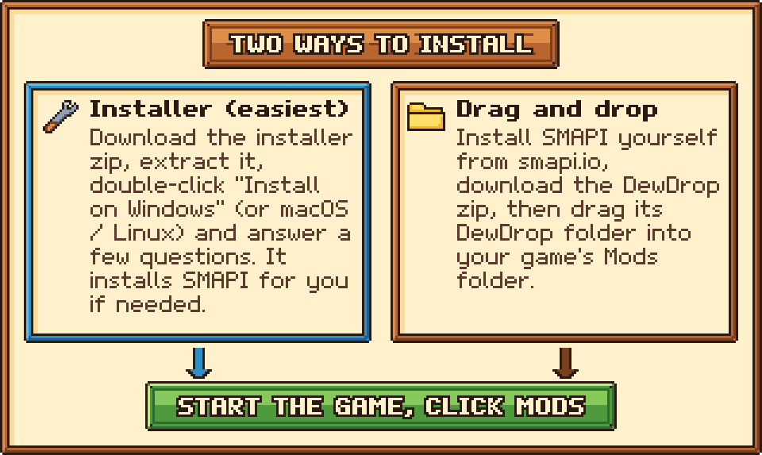
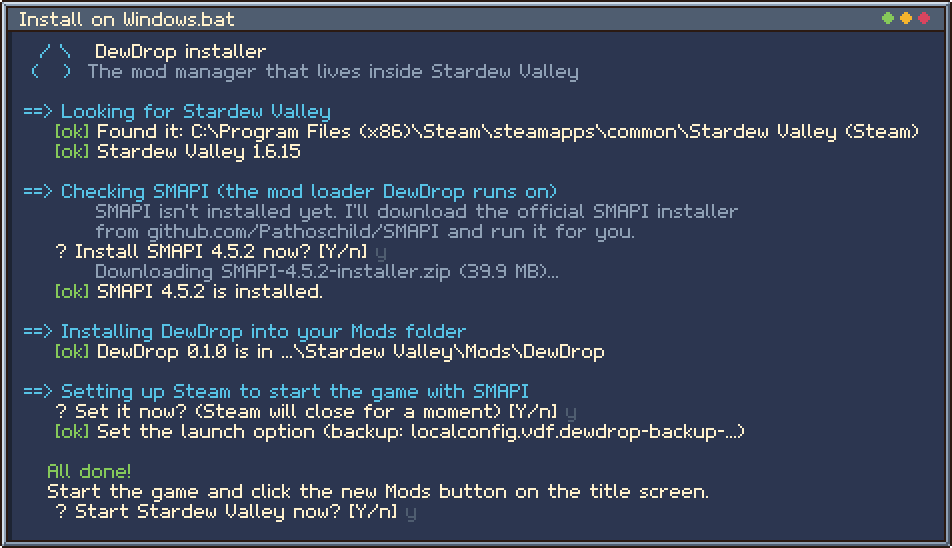
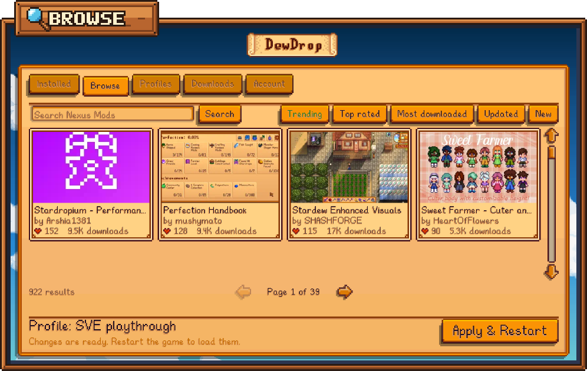
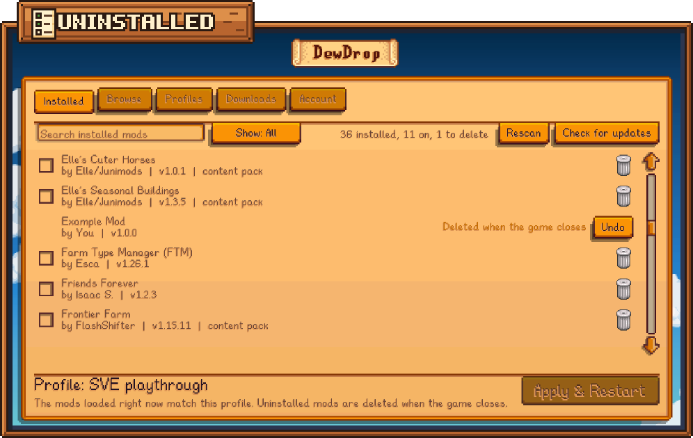
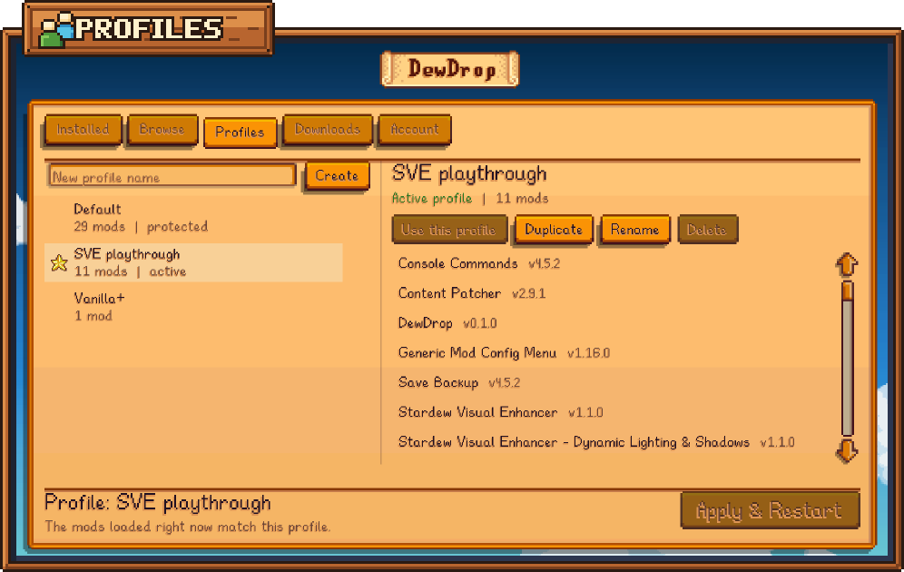
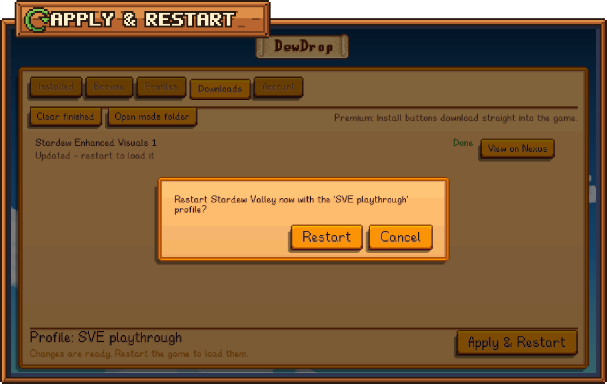
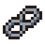
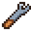

<p align="center">
  
</p>

<p align="center">
  <b>Browse, install and switch Stardew Valley mods without leaving the game.</b><br>
  DewDrop adds a <b>Mods</b> button to the title screen. It opens a mod manager drawn in the game's own style.
</p>

<p align="center">
  <a href="https://github.com/friessssss/DewDrop/releases/latest"><b>Download</b></a>
  &nbsp;·&nbsp;
  <a href="#install"><b>Install</b></a>
  &nbsp;·&nbsp;
  <a href="https://friessssss.gitbook.io/dewdrop/"><b>Read the guide</b></a>
  &nbsp;·&nbsp;
  <a href="https://friessssss.gitbook.io/dewdrop/help/faq">FAQ</a>
  &nbsp;·&nbsp;
  <a href="https://github.com/friessssss/DewDrop/issues">Report a problem</a>
</p>

<p align="center">
  
</p>


##  What you can do

<table>
  <tr>
    <td width="50%" valign="top">
      
      <b>Installed</b><br>
      Turn mods on and off, search and filter your list, spot missing requirements, update mods with a click, and
      uninstall the ones you're done with. An uninstalled mod can be kept with <b>Undo</b> until the game closes.
    </td>
    <td width="50%" valign="top">
      
      <b>Browse</b><br>
      Search Nexus Mods (trending, top rated, most downloaded, updated, new), see at a glance which mods you already
      have or can update, read a mod's page and install a file.
    </td>
  </tr>
  <tr>
    <td valign="top">
      
      <b>Profiles</b><br>
      Keep separate mod lists for different playthroughs. Create, duplicate, rename and switch between them.
    </td>
    <td valign="top">
      
      <b>Downloads</b><br>
      Follow downloads and installs as they happen, cancel them, or retry one that failed.
    </td>
  </tr>
  <tr>
    <td valign="top">
      
      <b>Account</b><br>
      Connect your Nexus Mods account, set up "Mod manager download" links (Windows), and change settings.
    </td>
    <td valign="top">
      
      <b>Apply &amp; Restart</b><br>
      One button loads your profile: DewDrop links its mods and restarts the game through SMAPI for you. With the
      Steam version on Windows or a Steam Deck, Steam's <b>Play</b> button can start the game straight in your
      profile, too.
    </td>
  </tr>
</table>

DewDrop works with the mods you already have. It reads your `Mods` folder where it is: nothing is moved, and
turning a mod off only changes your profile. A mod you copy into `Mods` yourself is turned on in your profile,
like one you install from the menu, unless you turn off **Turn on mods when installed**.


<a id="whats-new"></a>

##  What's new in 0.2.0

DewDrop 0.2.0 is being prepared on the `development` branch. It isn't released yet, so the
[latest release](https://github.com/friessssss/DewDrop/releases/latest) is still 0.1.0.

| What's new | Pull request | Status |
| --- | --- | --- |
| **Uninstall mods** from the **Installed** tab or a mod's page, with **Undo** until the game closes. **Browse** recognizes more of the mods you have and tags them **Installed** or **Update**, a mod's page marks the file you have, and two copies of one mod are flagged **Installed twice**. | [#12](https://github.com/friessssss/DewDrop/pull/12) | Merged into `development` |
| **One-line installers:** paste one line into PowerShell on Windows, or into Terminal on macOS and Linux. | [#8](https://github.com/friessssss/DewDrop/pull/8), [#10](https://github.com/friessssss/DewDrop/pull/10) | Merged into `development` |
| **Apple Silicon Macs:** the installer offers to install Rosetta, which SMAPI's installer needs. | [#9](https://github.com/friessssss/DewDrop/pull/9) | Merged into `development` |
| **Steam Deck support:** set up once in Desktop Mode, then install, update and switch mods in Game Mode. **Start in my profile from Steam** works there too, and on other Linux systems after the installer's `--steam-setup`. | [#11](https://github.com/friessssss/DewDrop/pull/11) | Draft. Checks pass; waiting on a test on a real Steam Deck and a review. |

Still to do for the release: finish and merge [#11](https://github.com/friessssss/DewDrop/pull/11), bump the version to 0.2.0, then merge the "Release 0.2.0" pull
request from `development` into `master`, which publishes the release. The guide's
[What's in progress](https://friessssss.gitbook.io/dewdrop/contributing/contributing#whats-in-progress) has the details.


<a id="install"></a>

##  Install

You need **Stardew Valley 1.6 or later** on Windows, macOS, Linux or a Steam Deck. DewDrop runs on
[SMAPI](https://smapi.io) 4.0 or later, the standard mod loader; the installer sets it up for you if you need it.

> [!NOTE]
> The one-line installers arrive with DewDrop 0.2.0. Until it's released, pasting the line shows a 404 error:
> use [the installer download](#if-youd-rather-download-the-installer) instead.

<p align="center">
  
</p>

### The easy way: the installer

Paste one line, and the installer does the rest. It finds your game, installs SMAPI if you need it, puts the
latest DewDrop in your `Mods` folder and offers to start the game.

**Windows:** open **PowerShell** (click **Start**, type `PowerShell` and press **Enter**), paste this and press
**Enter**:

```powershell
irm https://raw.githubusercontent.com/friessssss/DewDrop/master/install.ps1 | iex
```

**macOS or Linux:** open **Terminal**, paste this and press **Return**:

```bash
curl -fsSL https://raw.githubusercontent.com/friessssss/DewDrop/master/install.sh | bash
```

**Steam Deck:** switch to Desktop Mode once and paste the macOS or Linux line into **Konsole**. The installer also
sets Steam up so mods load in Game Mode. See
[DewDrop on the Steam Deck](https://friessssss.gitbook.io/dewdrop/getting-started/steam-deck).

Answer the questions: pressing **Enter** picks the recommended answer. Then start the game and click **Mods** on
the title screen.

A second window, SMAPI's, opens next to the game and lists what's loading. Leave it open: closing it closes the
game. (On a Steam Deck, or on Linux after the installer's `--steam-setup`, DewDrop's Steam launcher starts SMAPI
without that window.)

#### If you'd rather download the installer

1. Download **`DewDrop-<version>-installer.zip`** from the
   [latest release](https://github.com/friessssss/DewDrop/releases/latest).
2. Extract it. On Windows, right-click it and choose **Extract All...**; on a Mac, Safari usually unzips it for you.
3. Open the **`DewDrop <version> installer`** folder (on Windows, it's inside the folder that Extract All made) and
   double-click the file for your system:
   - **Windows:** `Install on Windows.bat` (it may show as just "Install on Windows"). If you see *"Windows
     protected your PC"*, click **More info**, then **Run anyway**. Windows shows this for new downloads it
     doesn't recognize yet.
   - **macOS:** `Install on macOS.command`. If macOS says it can't be opened, click **Done** (not **Move to
     Trash**), then go to **System Settings** > **Privacy & Security**, scroll down, click **Open Anyway** and
     enter your password. The Terminal line above skips this step.
   - **Linux:** `Install on Linux.sh`. If it opens in a text editor instead, right-click an empty spot in the
     folder, choose **Open in Terminal**, and run:

     ```bash
     bash "Install on Linux.sh"
     ```
4. Answer the questions, then start the game and click **Mods** on the title screen.

<details>
<summary><b>What does the installer do?</b></summary>
<br>

- **Finds Stardew Valley:** Steam (including extra library folders), GOG, the Xbox app and the usual install
  folders. If it can't find the game, it asks you to show it the folder.
- **Checks SMAPI:** if it's missing or older than 4.0, it downloads the **official** SMAPI installer from
  [github.com/Pathoschild/SMAPI](https://github.com/Pathoschild/SMAPI) and runs it for you. If a newer SMAPI is
  out, it offers to update. On a Mac with an Apple chip, it first offers to install Rosetta, Apple's free add-on
  that SMAPI's installer needs.
- **Installs DewDrop** into `Mods/DewDrop`. If you already have DewDrop, it updates that copy in place and keeps
  your `config.json`; if yours is newer than the installer's, it keeps yours. If you have more than one copy, it
  offers to turn the extras off.
- **Windows and Steam:** it offers to set the launch option that makes Steam's **Play** button start SMAPI, for the
  Steam account you're signed in with. It backs up Steam's settings first and won't replace launch options you set
  yourself unless you say so. It also asks whether Steam should start the game in your DewDrop profile; if you say
  yes, DewDrop finishes that the next time you quit the game.
- **Xbox app:** it swaps in SMAPI's copy of the game's exe (SMAPI's documented way). On other Windows setups, it
  can add a desktop shortcut instead.
- **A protected game folder** (for example under Program Files): it offers to restart itself as administrator.
- **macOS and Linux:** SMAPI's own installer sets the game up to start SMAPI, so nothing else is needed.
- **Steam Deck** (or Linux with `--steam-setup`): it sets Steam's launch option to DewDrop's launcher, which starts
  SMAPI without a terminal window, and in your profile if you like. Steam closes for a few seconds for this, after
  the installer's questions. On a Deck, it also offers to take your Nexus Mods API key, so you don't have to type
  it in Game Mode.
- **Finally,** it offers to start the game (not on a Steam Deck, where you start it in Game Mode).

It never deletes your mods, saves or settings; an old DewDrop copy is only removed once the new one is in place.
It keeps a log, `DewDrop-installer.log`, in your temp folder.

<p align="center">
  
</p>
</details>

### The manual way: drag and drop

1. Install [SMAPI](https://smapi.io) 4.0 or later, if you haven't already. The
   [SMAPI install guide](https://stardewvalleywiki.com/Modding:Player_Guide/Getting_Started) walks you through it.
2. Download **`DewDrop-<version>.zip`** from the [latest release](https://github.com/friessssss/DewDrop/releases/latest).
3. Open the zip and drag the **`DewDrop`** folder into your game's **`Mods`** folder.
   In Steam, right-click Stardew Valley > **Manage** > **Browse local files** to find it.
4. Start the game through SMAPI and click **Mods** on the title screen. On Windows, that means running
   `StardewModdingAPI.exe` in your game folder or setting Steam's launch option (see
   [About SMAPI](https://friessssss.gitbook.io/dewdrop/getting-started/installing/smapi)); on macOS and Linux,
   start the game as usual.

Aim for `Mods/DewDrop/manifest.json`. If yours is one level deeper (`Mods/DewDrop/DewDrop/...`), move the inner
`DewDrop` folder straight into `Mods` and delete the empty outer one. On a Steam Deck, use the installer instead:
without its Steam setup, Game Mode can show a black screen or a terminal window.

The [install guide](https://friessssss.gitbook.io/dewdrop/getting-started/installing) has the details for each
platform, store and setup.


##  Good to know

**Your profile loads when the game starts in it.** SMAPI picks the folder it loads mods from as the game starts,
so a normal start loads everything in your `Mods` folder. Two things get you into your profile instead:

- **Start in my profile from Steam** (Steam version, on Windows or a Steam Deck): tick it on the **Account** tab,
  and Steam's **Play** button starts the game straight in your profile. On Windows, DewDrop saves this in Steam
  when you quit the game, so Steam closes and opens again once. On a Steam Deck (and on Linux after the
  installer's `--steam-setup`), it counts at once.
- **The "Load your profile?" box:** after any other start, when the mods that loaded differ from your profile,
  DewDrop asks on the title screen. Click **Restart now**, and the game restarts in your profile. If they already
  match, it doesn't ask. You can turn the question off with **Ask to load my profile** on the **Account** tab.

**Apply & Restart** in the menu loads your profile any time. More in
[How launching works](https://friessssss.gitbook.io/dewdrop/getting-started/launching).

<p align="center">
  
</p>

- **The Mods button is on the title screen only.** Mods can't be safely loaded or unloaded while you play, so
  changes take effect when the game starts again: with **Apply & Restart**, or the next time Steam starts the
  game in your profile.
- **Nexus Mods is optional.** Turning mods on and off, profiles, update checks and browsing work without an
  account. To install mods from inside the game, connect a free or Premium account with your personal API key.
  Premium downloads straight into the game. Free accounts click **Slow download** on the website, and on Windows
  DewDrop can pick the file up from there once you set it as the "Mod manager download" handler.
- **Windows is the main, tested platform.** The mod is cross-platform, but macOS and Linux haven't been tested
  much yet, and "Mod manager download" links only work on Windows. **Steam Deck** support is new and being tested.
  Proton isn't supported: on Linux, DewDrop needs the Linux version of the game.

See the [guide](https://friessssss.gitbook.io/dewdrop/) for everything else, including the
[FAQ](https://friessssss.gitbook.io/dewdrop/help/faq) and
[troubleshooting](https://friessssss.gitbook.io/dewdrop/help/troubleshooting).


##  Screenshots

<table>
  <tr>
    <td width="50%"></td>
    <td width="50%"></td>
  </tr>
  <tr>
    <td></td>
    <td></td>
  </tr>
  <tr>
    <td></td>
    <td></td>
  </tr>
  <tr>
    <td></td>
    <td></td>
  </tr>
</table>


##  Works alongside Stardrop

DewDrop shares [Stardrop](https://github.com/Floogen/Stardrop)'s data folder on purpose: the same profiles,
settings, Nexus login and `Selected Mods` folder. You can use both and switch between them freely. If you
already use Stardrop, start the game once from Steam (or tick DewDrop in Stardrop) so DewDrop can add itself to
your profiles. Nexus collections still install through Stardrop. More in
[Using DewDrop with Stardrop](https://friessssss.gitbook.io/dewdrop/nexus-mods/stardrop).

##  Building from source

You need the .NET 6 SDK (or later) and Stardew Valley with SMAPI 4 installed. The build deploys DewDrop into your
game's `Mods/DewDrop` folder:

```bash
dotnet build DewDrop.sln
```

Debug builds (the default) also include a debug bridge for automated testing. The unit tests don't need the game:

```bash
dotnet test DewDrop.Core.Tests/DewDrop.Core.Tests.csproj
```

To make the two release downloads, run the packager. It needs Node.js 18 or later and builds in Release for you:

```bash
node tools/package-release.mjs
```

See [Building from source](https://friessssss.gitbook.io/dewdrop/contributing/building),
[the debug bridge](https://friessssss.gitbook.io/dewdrop/contributing/debug-bridge) and
[docs and art style](https://friessssss.gitbook.io/dewdrop/contributing/docs-and-art) (every image in these docs is
generated by `node tools/docs-art/build.mjs`). Issues and pull requests are welcome; see
[CONTRIBUTING.md](CONTRIBUTING.md).

##  Credits and license

DewDrop began as a fork of [Stardrop](https://github.com/Floogen/Stardrop) and is not affiliated with or endorsed
by Stardrop's authors. Thanks to [Floogen](https://github.com/Floogen) and the Stardrop contributors, to
[Pathoschild](https://github.com/Pathoschild) for [SMAPI](https://smapi.io), and to the mod authors on
[Nexus Mods](https://www.nexusmods.com/stardewvalley) whose work appears in the screenshots.

DewDrop is licensed under the [GNU General Public License v3.0](LICENSE). Stardew Valley is a trademark of
ConcernedApe; DewDrop is a fan-made mod and isn't affiliated with ConcernedApe.
