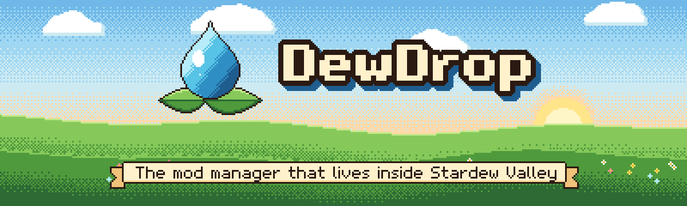
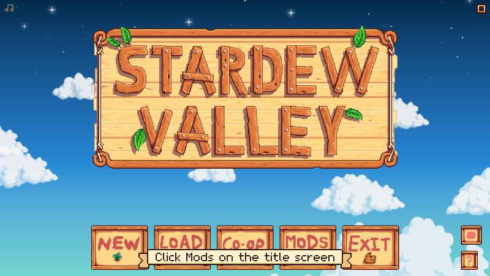

# Welcome to DewDrop

<figure></figure>

DewDrop is a mod manager that lives inside Stardew Valley. It adds a **Mods** button to the title screen, where you can turn mods on and off, find and install mods from the Nexus Mods website, and keep different sets of mods in profiles. It runs on SMAPI, the free tool that loads Stardew mods. The installer sets it up for you.

<figure><figcaption>
From the title screen to your mods in one click.
</figcaption></figure>

## What you can do

*  **Installed**: turn mods on and off, search your list, spot missing requirements, and update and uninstall mods. See [Managing your mods](guides/installed.md).
*  **Browse**: search and sort Nexus Mods, and install a file from a mod's page. Installing needs a free or Premium Nexus Mods account. See [Browsing Nexus Mods](guides/browse.md).
*  **Profiles**: create, switch, duplicate, rename and delete profiles. See [Profiles](guides/profiles.md).
*  **Downloads**: follow your downloads, cancel them, or try a failed one again. See [Downloads](guides/downloads.md).
*  **Account**: log in to Nexus Mods, let the website's download buttons send files to DewDrop (Windows only), and change settings. See [Connecting your Nexus account](nexus-mods/connecting.md).
*  **Apply & Restart**: restart the game with exactly the mods in your profile. See [Apply & Restart](guides/apply-and-restart.md).


DewDrop is built and tested on Windows. It's built to work on macOS and Linux too, but it hasn't been tested there yet, and some Nexus Mods download features are Windows only. Steam Deck isn't supported. See [Platform support](reference/platform-support.md).

Trying it is safe: the installer never deletes your mods, saves or settings, and you can remove DewDrop again in a few steps ([Uninstalling DewDrop](getting-started/uninstalling.md)). If you try it on macOS or Linux, please [tell us how it went](https://github.com/friessssss/DewDrop/issues).


## Get started

<table data-view="cards">
  <thead>
    <tr>
      <th></th>
      <th></th>
      <th data-hidden data-card-target data-type="content-ref"></th>
    </tr>
  </thead>
  <tbody>
    <tr>
      <td><strong>Start here</strong></td>
      <td>The quick start: install DewDrop, open the Mods menu and switch to your first profile in a few minutes.</td>
      <td><a href="quick-start.md">quick-start.md</a></td>
    </tr>
    <tr>
      <td><strong>Install</strong></td>
      <td>More detail on installing, with the installer or by dragging DewDrop into your Mods folder yourself.</td>
      <td><a href="getting-started/installing/README.md">getting-started/installing/README.md</a></td>
    </tr>
    <tr>
      <td><strong>Your first launch</strong></td>
      <td>More detail on the Mods button, your Default profile and when the game needs a restart.</td>
      <td><a href="getting-started/first-launch.md">getting-started/first-launch.md</a></td>
    </tr>
    <tr>
      <td><strong>Help</strong></td>
      <td>Fixes for common problems, answers to common questions, and how to report a bug.</td>
      <td><a href="help/README.md">help/README.md</a></td>
    </tr>
  </tbody>
</table>

## About DewDrop

DewDrop is free and open source under the GPL-3.0 license. You can download it from the [latest release on GitHub](https://github.com/friessssss/DewDrop/releases/latest).

DewDrop shares its profiles and Nexus Mods login with [Stardrop](stardrop.md), another mod manager, so you can use both. You don't need Stardrop.

DewDrop began as a fork of Stardrop's code and is not affiliated with or endorsed by Stardrop's authors. Thank you to [Floogen](https://github.com/Floogen) and the Stardrop contributors, and to [Pathoschild](https://smapi.io/) for SMAPI.
