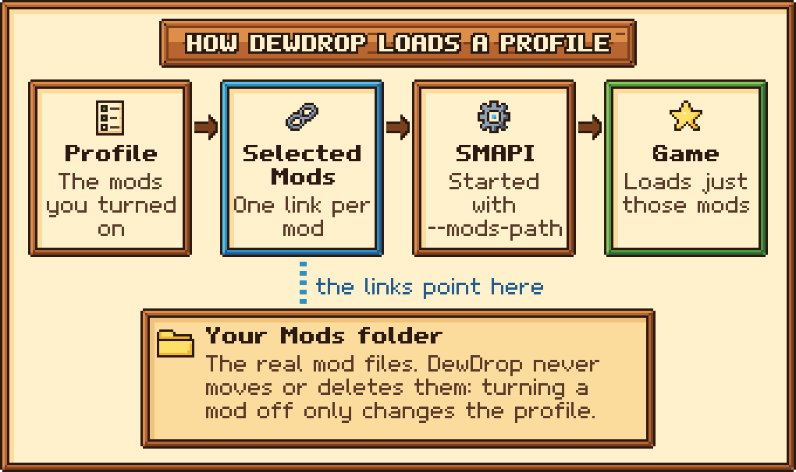
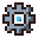

# Docs and art style

This guide and the README share one voice and one look. Every picture is pixel art in a fixed palette, drawn by code, with real in-game screenshots set in wooden frames. This page explains how to change the words or the pictures without breaking that consistency.

## Where the docs live

Every page is a Markdown file in the `docs/` folder of the repo. GitBook publishes them as [the DewDrop guide](https://friessssss.gitbook.io/dewdrop/) through **Git Sync**: changes merged into the repo show up on the site, and edits made in GitBook's editor are committed back to the repo.

Two small files tell GitBook what to sync. `gitbook-docs.yaml`, at the repo root, describes the site: one space, the guide, whose content is the `docs/` folder.


```yaml
$schema: https://api.gitbook.com/gitbook-docs.yaml
site:
  title: DewDrop
  structure:
    - type: space
      key: guide
      title: Guide
      path: guide
      default: true
      content:
        directory: ./docs
        language: en
```


`docs/.gitbook.yaml` then says which files in that folder are the home page and the sidebar:


```yaml
root: ./
structure:
  readme: README.md
  summary: SUMMARY.md
```


Don't change the space's `key`: GitBook treats a new key as a new space and drops the old one.

* `docs/README.md` is the guide's home page. The `README.md` in each folder is that section's first page.
* `docs/SUMMARY.md` is the sidebar. GitBook leaves out any page that isn't listed there, and each file can appear in it only once.
* Images live in `docs/.gitbook/assets/`. Pages link to them with relative paths, such as `../.gitbook/assets/logo.png` from a page one folder deep.
* The repo's own `README.md`, at the root, is what GitHub shows. GitHub prints GitBook blocks like hints and tabs as plain text, so that file uses only GitHub Markdown and HTML.

Git Sync itself is connected in GitBook's settings, not in the repo.

### Adding a page

1. Create the `.md` file in the right folder under `docs/`.
2. Start it with front matter and a single `#` title:

   ```markdown
   ---
   description: "One sentence that says what the page is for."
   icon: book
   ---

   # Page title
   ```

   The `icon` is a Font Awesome name, such as `download`, `rocket`, `gear` or `circle-question`.
3. Add the page to `docs/SUMMARY.md`, under its folder's `README.md`.
4. Link to it from related pages with relative `.md` links, for example `../guides/profiles.md`.


Always put the `description` in quotes. An unquoted `:` can make the front matter invalid, an unquoted `#` can cut the description short, and invalid front matter can make GitBook's sync fail. Manage `README.md` files in git only; creating them in GitBook's editor causes duplicates.


## How we write

* **Write for a beginner.** Use "you", plain words and short sentences. Never assume the reader knows what SMAPI, a `Mods` folder or a launch option is: explain it once and link to that explanation elsewhere.
* **Lead with what the reader wants to do.** Keep one idea per paragraph, and use numbered steps for anything they have to do.
* **Match the game's words exactly.** Put UI labels in bold, written as the menu writes them: **Apply & Restart**, **Show: Enabled**, **Get my API key**. Write menu paths with `>`, like **Account** tab > **Nexus Mods** panel. Put file names and paths in `code`.
* **Show keys and buttons in bold:** **Esc**, **Enter**, **Ctrl+V**, and controller buttons **A**, **B**, **Start**.
* **Keep the tone calm.** No marketing, no emojis, and no pile of exclamation marks; one friendly "That's it!" at the end of a procedure is fine. Don't write "simply" or "just" about anything that can go wrong.
* **Spell names one way.** Use US English, and write DewDrop, Stardrop, SMAPI, Nexus Mods and Stardew Valley exactly like that.
* **Be honest.** Say plainly what doesn't work on a platform yet. Only document what the code really does; when you're unsure, read the code.
* **Keep pages focused.** Most pages run 150 to 700 words. Reference pages can be longer.

### GitBook blocks

Use these blocks, and keep them simple:

* **Hints** for callouts. Use `info` for helpful context, `success` for "you're done", `warning` for anything that can lose data or break a setup, and `danger` only for destructive actions. Use about three per page at most.
* **Tabs** for steps that differ by platform (Windows, macOS, Linux).
* **Steppers** for the main install flow. Don't put hints or expandable blocks inside a stepper; put them after it.
* **Expandable blocks** (HTML `details` and `summary` tags) for FAQ entries and for optional detail most readers can skip.
* **Figures** for every screenshot and diagram, always with meaningful alt text.

Hints, tabs and steppers use GitBook's own tags, each on a line of its own: `hint` and `endhint` (with a `style`), `tabs` and `endtabs` around each `tab` and `endtab` (with a `title`), and `stepper` and `endstepper` around each `step` and `endstep`. Copy the exact syntax from an existing page: `docs/getting-started/installing/installer.md` uses a stepper, tabs, hints, an expandable block and figures. The tags aren't shown here because GitBook can read them as real blocks even inside a code block.

Expandable blocks and figures look like this:

```markdown
<details>
<summary>A question people ask?</summary>

The answer.

</details>

<figure><figcaption><p>A short caption.</p></figcaption></figure>
```

## The art style

Every image is built from a few shared pieces:

* **The meadow:** a dawn sky, rolling hills, flowers and dew sparkles. It sits behind the banner, and a thin strip of it makes the grass divider.
* **Plaques:** wooden signs with lettering, used as labels and headings inside images.
* **Panels:** a wooden frame around parchment, like a Stardew Valley menu box.
* **Framed screenshots:** a real in-game screenshot inside a wooden frame, with a plaque label across the top edge.
* **Diagrams:** parchment cards, each with an icon, a bold title and a line or two of text, joined by thick pixel arrows.
* **Icons:** 16×16 pixel sprites with a one-pixel dark outline, saved at 64 pixels.

<figure><figcaption><p>A real screenshot, framed by the art pipeline.</p></figcaption></figure>

<figure><figcaption><p>A diagram built from cards and arrows.</p></figcaption></figure>

Here are a few icons at line height:      

## The palette

Every generated pixel comes from the tokens in `tools/docs-art/lib/palette.mjs`. That shared palette is what makes the banner, icons, diagrams and frames look like one set.

| Group | Tokens |
| --- | --- |
| Outline and text | `ink` #2b1a12 (outlines and dark text), `inkSoft` #5a3a28 (secondary text, shadows on paper) |
| Wood and parchment | `woodDark` #7a3f1d, `wood` #b8652f, `woodLight` #dd8f4a, `paperShade` #f0c27a, `paper` #fbdc9c, `paperLight` #fff1cc |
| Dew (the brand color) | `dewDeep` #1f5d8f, `dewMid` #2f8fc4, `dew` #57c3e6, `dewLight` #b6ecfa, `white` #ffffff |
| Leaves and hills | `leafDark` #2d6a34, `leaf` #4f9a3c, `leafLight` #86c95a, `leafPale` #c4e88a |
| Dawn sky | `skyTop` #6fb8e8, `sky` #9fd7f2, `skyLow` #cdeaf2, `dawn` #ffd9a8, `sun` #ffe58a, `sunCore` #fff6c8 |
| Metal | `steelDark` #4f5d70, `steel` #8fa1b5, `steelLight` #d4dfea |
| Night (terminal backgrounds) | `night` #1d2433, `nightSoft` #2c3650 |
| Signals (callouts, warnings) | `berry` #d9455f, `berryLight` #f28b9a, `gold` #f5b52e, `goldLight` #ffe066, `plum` #6a4c93 |

There is also `clear`, which is fully transparent. If you need a new color, add a token to `palette.mjs`; never write a color value straight into drawing code.

## The pixel font

The lettering in every image is **Dewdrop Sans**, a pixel font defined in `tools/docs-art/lib/font.mjs`.

* Capital letters are 7 pixels tall, and lines are 11 pixels apart, including room for descenders.
* Letters have different widths, with one pixel of space between them.
* It covers upper and lower case, digits, common punctuation, and a few symbols for diagrams: → ← ↓ ✓ ✗ • … ♥ ★.
* Any character it doesn't have is drawn as `?`. Check your text after a build.
* Bold thickens each letter. **M**, **W**, **m** and **w** have hand-drawn bold shapes so they don't clog up.
* Text is drawn at whole-number scales (plaques use 2×), optionally with a dark outline and a drop shadow.

## The art pipeline

The code lives in `tools/docs-art/`. It needs nothing but Node.js: it uses Node's built-in modules only, so there is nothing to install. To redraw every image into `docs/.gitbook/assets/`, run this from the repo folder:

```bash
node tools/docs-art/build.mjs
```

To redraw just one group, pass `--only` with one or more of `banner`, `logo`, `social`, `divider`, `icons`, `shots`, `tour`, `diagrams` and `terminal`, for example `node tools/docs-art/build.mjs --only=shots,tour`.

Two images aren't used on any page: `social-preview.png` is the 1280×640 picture for the GitHub repository's social preview (repository **Settings** > **Social preview**), and `logo-small.png` is a 64×64 logo for the GitBook site icon.

Random details, like where clouds and flowers go, come from fixed seeds. Every build therefore draws the same pixels, and a git diff only shows images you really changed.

| File | What it holds |
| --- | --- |
| `lib/palette.mjs` | The color tokens (`P`) and `css()`, which turns a token into a hex string. |
| `lib/font.mjs` | Dewdrop Sans: the glyphs, plus `measure`, `wrap` and `rasterize`. |
| `lib/canvas.mjs` | `Canvas`, a small RGBA drawing surface at one art pixel per canvas pixel. It has shapes, dithering, gradients, outlines and text. `blitResized` shrinks real screenshots smoothly, `scaled(n)` enlarges art with hard pixel edges, and `save` writes a PNG. |
| `lib/png.mjs` | A PNG reader and writer, and an animated-PNG writer for animations such as `demo-tour.png`. |
| `lib/components.mjs` | The building blocks: `dewDrop`, `leaf`, `logoMark`, `panel`, `plaque`, `arrow`, `icon` (with `ICON_NAMES`), `framedShot` and `card`. |
| `lib/scenes.mjs` | Larger scenes: `sky`, `cloud`, `hills`, `sparkle`, `meadow`, `banner`, `ribbon` and `divider`, plus the seeded random generator `rng`. |
| `build.mjs` | Draws every image the docs use and saves it into `docs/.gitbook/assets/`. |

### The main components

* `panel(w, h, { fill, border })`: a framed box. Fills are `paper`, `shade`, `dew`, `night` and `leaf`. Borders are `wood`, `dew`, `leaf`, `berry`, `gold` and `steel`.
* `plaque(text, { scale, border, fill })`: a wooden sign with centered bold lettering. Borders are `wood`, `dew`, `leaf`, `gold` and `berry`, and fills can also be `paper`.
* `framedShot(shot, { width, label, iconName })`: puts a real screenshot in the wooden frame. The screenshot is shrunk smoothly to `width` pixels (960 by default). The frame is drawn in art pixels at 3× scale, with the label on a plaque that overlaps the top edge.
* `card(title, body, { width, iconName, border, fill })`: a parchment card with an icon, a bold title and wrapped text, for diagrams.
* `stackedNode(title, body, { width, iconName, border, minHeight })`: a diagram step with the icon on top and centered text. `nodeHeight` tells you how tall one will be, so a row of steps can share a height; `build.mjs` lays rows out with its `flowRow` helper.
* `arrow(canvas, x0, y0, x1, y1)`: a thick arrow. It only draws horizontal or vertical arrows.
* `icon(name)`: one of the 16×16 icons.

### Adding an icon

Each icon is drawn in `lib/components.mjs` as 16 rows of 16 characters, one character per pixel. A `.` is transparent, and every other letter maps to a palette token:

| Letters | Colors |
| --- | --- |
| `k` `s` | `ink`, `inkSoft` |
| `W` `w` `l` | `woodDark`, `wood`, `woodLight` |
| `q` `p` `P` | `paperLight`, `paper`, `paperShade` |
| `D` `m` `d` `L` `H` | `dewDeep`, `dewMid`, `dew`, `dewLight`, `white` |
| `g` `G` `e` `E` | `leafDark`, `leaf`, `leafLight`, `leafPale` |
| `r` `R` `y` `Y` | `berry`, `berryLight`, `gold`, `goldLight` |
| `t` `T` `U` | `steelDark`, `steel`, `steelLight` |
| `n` `N` `u` | `night`, `nightSoft`, `plum` |

Every row must be the same length and use only these letters, or the build stops with an error. Give the icon a one-pixel `k` outline and light it from the upper left, like the others.

## Screenshots

Screenshots are the one place real game pixels appear. Each one is a real capture from the game, never a mock-up. When the menu changes, capture the screenshot again; never draw new UI onto an old capture.

1. Load a Debug build and capture with the [debug bridge](debug-bridge.md). Use the same setup every time: `window 1920 1080` and `uiscale 1.0`. Move your real mouse into a corner and wait for messages to clear before each `shot`. The `window` command changes the game's saved display settings, so back up `startup_preferences` in the game's data folder (`%AppData%\StardewValley` on Windows) first and put it back afterward. If the game window won't stay in front while you capture, set `pauseWhenOutOfFocus` to `false` in that file too, with the game closed. Otherwise the menu stops updating while the window is in the background (see [Timing and gotchas](debug-bridge.md#timing-and-gotchas)).
2. Check every capture for anything personal before you commit it, such as your Nexus Mods user name. Blur it in the raw capture itself, and list the area in `REDACT` in `build.mjs` as a second guard.
3. Save the raw captures in `tools/docs-art/shots/` under the names listed in `SHOTS` in `build.mjs`, then rebuild. Menu captures are cropped to the menu. `title-prompt.png`, the **Load your profile?** box, is cropped to the box with the fixed rectangle listed for it in `SHOTS`. `framedShot` adds the frame and label, and the result goes into `docs/.gitbook/assets/` as `shot-<name>.png`. Most of the same captures also make up the `demo-tour.png` animation.
4. Build Release again afterward so you don't keep playing on the Debug build.

The **Load your profile?** box only opens on a normal launch whose mods differ from your profile. To capture `title-prompt.png`, set that up as described in [Testing starting in your profile](debug-bridge.md#testing-starting-in-your-profile), then send `shot` once the box is open. The capture shows the box with its **Start in my profile from Steam from now on** checkbox, ticked, and the note under it. The box only shows that checkbox with the Steam version of the game on Windows, or on Linux and the Steam Deck with DewDrop's Steam launcher, while **Start in my profile from Steam** is off and can be used, and it starts unticked right after a restart that didn't come back. Capture it on a launch that meets those conditions, and answer **Not now** afterward so nothing changes.

The menu captures show a profile named **SVE playthrough**, with 11 of 36 mods on. Start the game in that profile, by starting SMAPI with `--mods-path` pointing at `Selected Mods` as **Apply & Restart** does, so the bottom bar says the mods loaded right now match it. `mod-page-installed.png` is Content Patcher's page, with its newest version installed.

`uninstall-dialog.png` and `uninstalled.png` show a stand-in mod, never one of your real mods:

1. Put a folder named `Example Mod` in your `Mods` folder, holding only a `manifest.json` with the name **Example Mod**, the author **You**, the version `1.0.0`, a made-up unique ID and an `EntryDll`.
2. Click **Rescan**. If that turned the mod on, turn it off again.
3. Scroll it into view with `key Down`, click its trash can, `wait 300` and `shot` the dialog. Then send `key Escape`.
4. Send `uninstall` with its unique ID, and `shot` the row.

DewDrop moves the folder out of `Mods` when the game closes and deletes it at the next start.

## Rules

1. **Never hand-edit a generated PNG.** Change the code in `tools/docs-art/` and rebuild. The next build would overwrite a hand edit anyway.
2. **Commit the code change and the redrawn PNGs together**, so the repo always matches what the pipeline draws.
3. **Draw only with palette colors.** Real screenshots are the only exception.
4. **Ship no game art except real screenshots.** Don't copy Stardew Valley sprites, fonts or textures into the art code or the assets folder. Don't commit the images that `dewdrop_export_title` writes, either: they're made from the game's own title-button art. DewDrop itself ships no game art; it builds its **Mods** button from the game's textures while the game runs.
5. **Give every image meaningful alt text.** Only purely decorative inline icons can use `alt=""`.
6. **Keep image file names stable.** Pages and the README link to them by name, so if you rename one, update every link to it.
