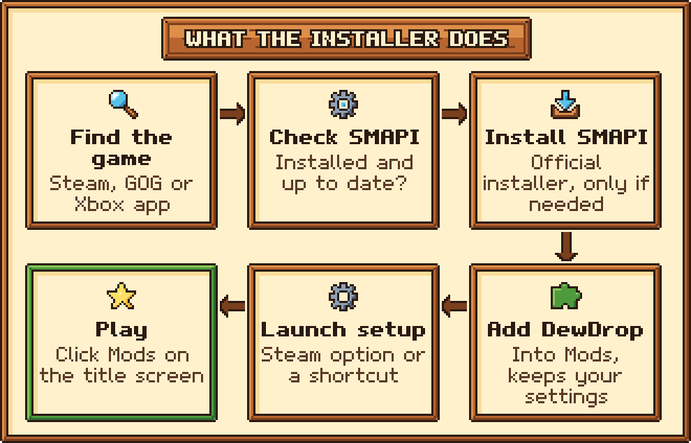

# Install with the installer

The installer does the fiddly parts for you. It finds your game, installs or updates SMAPI (the mod loader DewDrop runs on) if you need it, and copies DewDrop into your `Mods` folder. It asks before it changes anything important.

Before you start, check [What you need](../requirements.md). The installer has been tested on Windows, Linux and an Apple Silicon Mac (see [Platform support](../../reference/platform-support.md)). On a Steam Deck, follow [DewDrop on the Steam Deck](../steam-deck.md).

## The quick way: one line

Paste one line, and it downloads the installer and the latest DewDrop release and runs the installer in that window. Nothing is blocked this way, so there's no **Windows protected your PC** or **Privacy & Security** step.



Open **PowerShell** (click **Start**, type `PowerShell` and press **Enter**), paste this line and press **Enter**:

```powershell
irm https://raw.githubusercontent.com/friessssss/DewDrop/master/install.ps1 | iex
```

From Command Prompt instead, use this line:

```cmd
powershell -c "irm https://raw.githubusercontent.com/friessssss/DewDrop/master/install.ps1 | iex"
```



Open **Terminal** (on a Mac, press **Command + Space**, type `Terminal` and press **Return**), paste this line and press **Return**:

```bash
curl -fsSL https://raw.githubusercontent.com/friessssss/DewDrop/master/install.sh | bash
```

On a Steam Deck, paste it into **Konsole** in Desktop Mode. See [DewDrop on the Steam Deck](../steam-deck.md).



Then [answer the questions](#answer-the-questions) and [start the game](#start-the-game), as in the steps below. If the line shows an error instead of starting the installer, use the [download steps](#or-download-it-five-steps).

To add [installer options](../../reference/installer-options.md), such as `--dry-run` to preview what it would do, see [Running the installer with options](../../reference/installer-options.md#running-the-installer-with-options).

## Or download it: five steps

Prefer to download the installer and double-click it? These steps do the same as the one line.



### Download the installer

Open the [latest DewDrop release](https://github.com/friessssss/DewDrop/releases/latest). Under **Assets**, click `DewDrop-<version>-installer.zip`. You don't need the **Source code** downloads.



### Extract the zip

The installer can't run from inside the zip, so extract it first.

* **Windows:** right-click the zip, choose **Extract All...**, then click **Extract**. You get a `DewDrop-<version>-installer` folder with a `DewDrop <version> installer` folder inside it.
* **macOS:** double-click the zip.
* **Linux:** right-click the zip and choose your file manager's extract option.



### Run the installer for your computer

Open the `DewDrop <version> installer` folder and double-click the file for your computer:

* **Windows:** `Install on Windows.bat`. Windows may hide the `.bat` part, so it can show as **Install on Windows**.
* **macOS:** `Install on macOS.command`.
* **Linux:** `Install on Linux.sh`.

A window full of text opens. That's the installer. If your computer warns you about the file, see [Running the installer on your computer](#running-the-installer-on-your-computer), or use [the one line](#the-quick-way-one-line) instead.



### Answer the questions

At a yes/no question, the capital letter is the recommended answer: `[Y/n]` means yes, `[y/N]` means no. Press **Enter** to pick it, or type **Y** or **N** and press **Enter**. At a numbered list, type a number and press **Enter**.

Some questions depend on your setup:

* **A Mac with an Apple chip** may be asked **Install Rosetta now?** SMAPI's installer needs Rosetta, Apple's free add-on for Intel apps. Press **Enter**, type your Mac password (it doesn't show as you type) and press **Return**.
* **Steam on Windows:** it offers to set the game's launch option, so Steam's **Play** starts SMAPI. Steam closes for this, and opens again when the installer starts the game. It also asks **Start the game in your DewDrop profile when you press Play in Steam?** Press **Enter** for yes, and **Play** loads only your profile's mods. DewDrop finishes this the next time you quit the game, when Steam closes and opens again once. You can change it any time in **Mods** > **Account**.
* **Steam Deck:** it offers to take your Nexus Mods API key, sets Steam up to start the game with DewDrop's launcher, and asks the same profile question. It asks everything first, then closes Steam for a few seconds. Your answer about the profile counts at once. On other Linux systems, the [`--steam-setup` option](../../reference/installer-options.md#steam-on-linux-and-the-steam-deck) does the same, without the API key question.

<figure><figcaption><p>The installer on Windows.</p></figcaption></figure>

When you see **All done!**, DewDrop and SMAPI are installed.



### Start the game

The installer asks **Start Stardew Valley now?** Press **Enter**. (It doesn't ask for the Xbox app, or on a Steam Deck, where you start the game in Game Mode.) The downloaded installer then waits for one more **Enter** before it closes its window.

SMAPI's window opens next to the game and lists what's loading. Leave it open: closing it closes the game. On the title screen, click the new **Mods** button. That's it!




You're done. Next, read [Your first launch](../first-launch.md). To learn when your profile's mods load, and when the game needs a restart, see [How launching works](../launching.md).


## How to start the game from now on

| Your setup | Start the game with mods |
| --- | --- |
| Windows, Steam, launch option set by the installer | Press **Play** in Steam. If you said yes to starting in your DewDrop profile, **Play** starts the game in it once you've quit the game for the first time. |
| Windows, Steam, you said no to the launch option | Use the **Stardew Valley (SMAPI)** desktop shortcut. |
| Windows, GOG or another setup | Use the **Stardew Valley (SMAPI)** desktop shortcut. GOG Galaxy's **Play** button starts the game **without** mods unless you [set Galaxy up](smapi.md#gog-galaxy-on-windows). |
| Windows, Xbox app | Press **Play** in the Xbox app. |
| macOS or Linux | Start it however you usually do. Steam's **Play** button works. |
| Steam Deck, or Linux after `--steam-setup` | Press **Play** in Steam. DewDrop's Steam launcher starts SMAPI, in your profile if you said yes. |

If no SMAPI window opens, the game started without mods. There are two exceptions: DewDrop's Steam launcher never opens a SMAPI window, and on macOS a game that DewDrop restarted doesn't open a new Terminal window. If the **Mods** button is on the title screen, your mods loaded.

## Running the installer on your computer



**"Windows protected your PC":** click **More info**, then **Run anyway**. Windows shows this for new downloads it doesn't recognize yet. [The one line](#the-quick-way-one-line) avoids it.

**A message that starts with "Oops!":** the installer couldn't start, and the message says why. See [Troubleshooting](../../help/troubleshooting.md#the-installer-fails-to-start).

**It can't find your game:** in the folder picker, choose the folder with the Stardew Valley game icon in it (`Stardew Valley.exe`). To open it from Steam, right-click the game and choose **Manage** > **Browse local files**.

**"Windows won't let me change files":** the game is in a protected folder, such as Program Files. Let the installer restart itself as administrator, click **Yes** when Windows asks, and carry on in the new window. It still starts Steam and the game as you, not as administrator. Said no? [Troubleshooting](../../help/troubleshooting.md#windows-wont-let-the-installer-change-files) shows how to run it as administrator yourself, from the zip or with the one line.



**"Install on macOS.command" Not Opened:** macOS shows this for downloaded scripts that Apple hasn't checked. The easiest fix is [the Terminal line](#the-quick-way-one-line). Otherwise, click **Done** (not **Move to Trash**), open **System Settings** > **Privacy & Security**, scroll down, click **Open Anyway** and enter your password. On older macOS, right-click the file and choose **Open** instead.

**Double-clicking does nothing:** open Terminal, type `bash` and a space, drag `Install on macOS.command` into the window, and press **Return**.

**"Install Rosetta now?":** a Mac with an Apple chip (M1 or later) needs Rosetta to run SMAPI's installer, which is made for Intel Macs. Press **Enter** and type your Mac password. If you answer no, or Rosetta doesn't install, the installer stops. Install Rosetta yourself in Terminal, then run the installer again:

```bash
softwareupdate --install-rosetta
```

**"Operation not permitted":** macOS is blocking Terminal from your game folder. Switch on **Terminal** in **System Settings** > **Privacy & Security** > **Full Disk Access**, then run the installer again. You can switch it off there afterwards.

**macOS later says SMAPI is malware:** it says this about apps Apple hasn't checked. SMAPI is the standard, open-source Stardew Valley mod loader. See "Enable macOS security permissions" in [SMAPI's macOS guide](https://stardewvalleywiki.com/Modding:Installing_SMAPI_on_Mac).



**Double-clicking opens a text editor, or nothing happens:** right-click an empty spot in the folder, choose **Open in Terminal**, then run:

```bash
bash "Install on Linux.sh"
```

**"This is the Windows version of the game":** Steam is running it through Proton, Steam's tool for running Windows games on Linux. DewDrop needs the Linux version. In Steam, right-click **Stardew Valley** and choose **Properties** > **Compatibility**. Untick **Force the use of a specific Steam Play compatibility tool**, let Steam download the Linux version, then run the installer again.

**What it needs:** `curl` or `wget`, and `unzip` or `python3`. Most desktop Linux systems have them.



## What the installer does

<figure><figcaption><p>The installer's steps.</p></figcaption></figure>

<details>

<summary>What the installer does, step by step</summary>

1. **Finds your game** (Steam on any drive, GOG, the Xbox app or the usual folders), and asks which one you play if there are several.
2. **Checks the game:** version 1.6 or later on Windows, the Linux version rather than Proton on Linux, and whether the game has ever been started.
3. **Waits for the game to close.**
4. **Checks SMAPI.** If it's missing or older than 4.0, it downloads the official installer from [SMAPI's GitHub releases](https://github.com/Pathoschild/SMAPI/releases) and runs it, stopping it if it's stuck after 3 minutes. If a newer SMAPI is out, it offers the update. On a Mac with an Apple chip, it first makes sure Rosetta is installed. On macOS and Linux, if some game files belong to another user (for example, after a `sudo` install), it stops and shows the `sudo chown` command that fixes it.
5. **Copies DewDrop into `Mods/DewDrop`**, or updates your copy where it is and keeps your `config.json` settings. The old copy is only removed after the new one is in place. It doesn't swap a newer DewDrop for an older one unless you say yes.
6. **Offers to turn off extra copies** of DewDrop by putting a `.` at the start of their folder names, so SMAPI skips them.
7. **Reminds Stardrop users** what to do on their first launch.
8. **Sets up how you start the game:**
   * **Steam on Windows:** it sets the launch option `"<your game folder>\StardewModdingAPI.exe" %command%` for the signed-in Steam account, after closing Steam and backing up its `localconfig.vdf`. It replaces other launch options only if you say yes, and offers to fix one that starts SMAPI from another folder. It saves your answer about starting in your DewDrop profile in DewDrop's `config.json`; DewDrop adds SMAPI's `--mods-path` option the next time you quit the game. See [Starting in your profile](../../reference/installer-options.md#starting-in-your-profile).
   * **Xbox app:** it renames `Stardew Valley.exe` to `Stardew Valley original.exe` and puts a copy of SMAPI in its place. After a game update, run the installer again.
   * **Anything else on Windows:** it offers a **Stardew Valley (SMAPI)** desktop shortcut.
   * **Steam Deck** (or Linux with `--steam-setup`): on a Deck, it first offers to take your Nexus Mods API key, unless one is already saved. It sets the signed-in account's launch option to DewDrop's launcher. A launch option that only starts SMAPI is replaced, since the launcher starts SMAPI too. For other launch options you already have, it keeps what it can (such as `gamemoderun`) and asks first. It also asks whether Steam should start the game in your DewDrop profile, unless you already chose, here or in the game. Then it closes Steam, backs up its `localconfig.vdf`, makes the change and opens Steam again. See [Steam on Linux and the Steam Deck](../../reference/installer-options.md#steam-on-linux-and-the-steam-deck).
9. **Offers to start the game** (not for the Xbox app, or on a Steam Deck).

It never deletes your mods, saves or settings. SMAPI's installer adds or updates its two bundled mods, Console Commands and Save Backup.

</details>

## Running it again

Run the installer again whenever you like: to [update DewDrop](../updating-dewdrop.md) or SMAPI, to set up the Steam launch option or shortcut you skipped, or to redo the Xbox app setup after a game update.

If it says **Stardrop is installed too** and you don't use Stardrop, ignore it. DewDrop created the settings file the installer looks for.

## If something goes wrong

If the installer has to stop, it says why in a red `[x]` line. [Troubleshooting](../../help/troubleshooting.md#the-installer) explains the common messages.

It also saves a log, replacing the last one: `%TEMP%\DewDrop-installer.log` on Windows, or `DewDrop-installer.log` in `$TMPDIR` (or `/tmp`) on macOS and Linux. Attach it if you [ask for help](../../help/reporting-issues.md).

## Command-line options

To choose the game folder yourself, preview what the installer would do, or install without questions, see [Installer command-line options](../../reference/installer-options.md).
