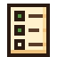
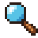
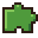
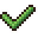
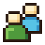
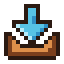
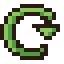
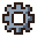

# Using DewDrop

Everything in DewDrop happens in one menu: click **Mods** on Stardew Valley's title screen. These guides go through it tab by tab. If you haven't installed DewDrop yet, start with the [Quick start](../quick-start.md).

*  [The DewDrop menu](the-menu.md): open and close it, read the bottom bar, and use it with a mouse, keyboard, controller or Steam Deck.
*  [Managing your mods](installed.md): turn mods on and off, find problems, and uninstall mods on the **Installed** tab.
*  [Browsing Nexus Mods](browse.md): search and sort mods on the **Browse** tab, and see which ones you already have.
*  [A mod's page and installing files](mod-page.md): pick a file and install it, or uninstall the mod.
*  [Updating mods](updating-mods.md): how DewDrop finds updates and installs them.
*  [Profiles](profiles.md): keep different sets of mods and switch between them.
*  [Downloads](downloads.md): follow, cancel and retry downloads.
*  [Apply & Restart](apply-and-restart.md): restart the game with your profile's mods.
*  [Start in your profile](start-in-your-profile.md): have Steam's **Play** button start the game in your profile (Steam version, on Windows, Linux and the Steam Deck), or let DewDrop offer a restart into it.
*  [Settings](settings.md): the options on the **Account** tab.


New to profiles and restarting? Read [How launching works](../getting-started/launching.md) first. It explains why mods you turned off can still load when you start the game from a shortcut, and how **Apply & Restart** fixes that.


Playing on a Steam Deck? The menu works in Game Mode. [DewDrop on the Steam Deck](../getting-started/steam-deck.md) covers the setup and what's different there.
