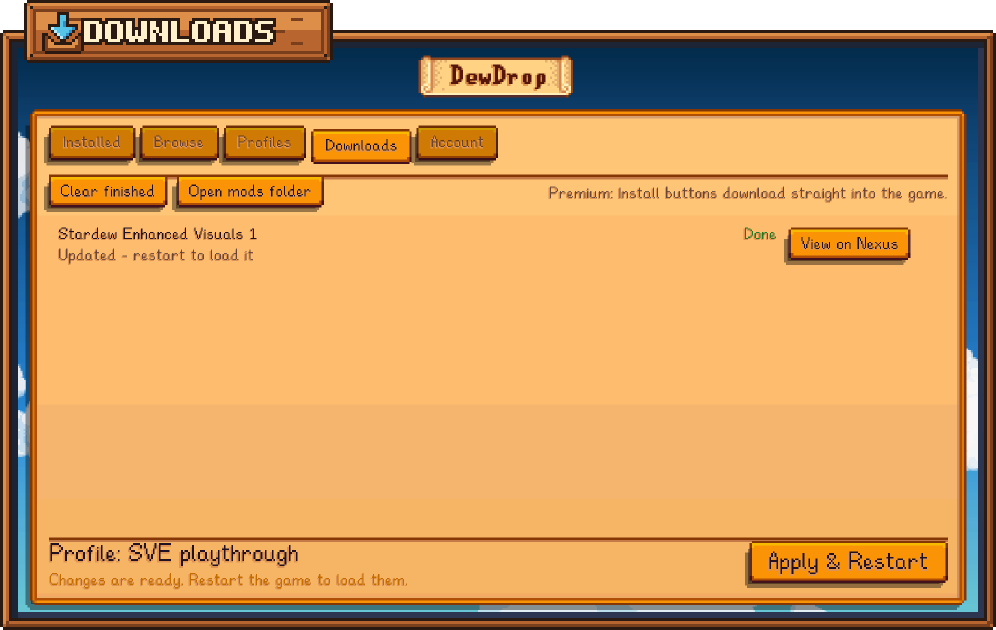

# Downloads

The **Downloads** tab lists the mod files DewDrop has downloaded, or is downloading, since the game started: mods you install from [Browse](browse.md), [updates](updating-mods.md), and, on Windows, files the Nexus Mods website sends to DewDrop.

<figure><figcaption>
The Downloads tab.
</figcaption></figure>

## The buttons at the top

* **Clear finished** removes finished and failed downloads from the list.
* **Open mods folder** opens the folder DewDrop installs new mods into, normally your game's `Mods` folder. On a Steam Deck in Game Mode it's grayed out, because there's no file manager there. It works in Desktop Mode.
* **Log in** appears when you aren't logged in to Nexus Mods. It takes you to the **Account** tab.
* **Set up** appears on Windows for free accounts when DewDrop doesn't handle the website's download links yet. It also takes you to the **Account** tab. See ["Mod manager download" links](../nexus-mods/mod-manager-links.md).

Next to them, a short note says how downloads work for your account, for example "Premium: Install buttons download straight into the game."

## Read the list

The newest download is at the top. Each row shows the mod's name and its state on the right:

| State | What it means |
| --- | --- |
| **Queued** | Waiting its turn: "Waiting to start...". DewDrop downloads one file at a time. |
| **Downloading** | Shows a percentage and a progress bar. |
| **Installing...** | DewDrop is unpacking the file into your `Mods` folder. |
| **Done** | Installed. The second line says "Installed 1 mod", "Updated" or "Update ready, finishes when the game restarts", and adds "restart to load it" when a restart is needed. |
| **Failed** | The reason is shown in red. See [When a download fails](#when-a-download-fails). |

Click a **Done** row to jump to the **Installed** tab. Point at a row for more, such as the Nexus mod and file numbers and when it started. While downloads are running, the tab's name shows how many, for example **Downloads (1)**.

### Row buttons

* **Cancel** stops a download that's queued or still downloading. The row then shows **Failed** with "Cancelled." A file that's already installing can't be cancelled.
* **Retry** appears on a failed download for Premium accounts, and downloads the file again. Free accounts see **Get on Nexus** instead, which opens the file on the website so you can click **Slow download** again.
* **View on Nexus** opens the mod's page on the Nexus Mods website.

For Premium accounts, **Retry** isn't offered when trying again can't help, for example when Nexus Mods no longer has the file. If DewDrop has installed the file since it failed, for example from the mod's page, **Retry** removes the row and says "*title* is already installed."

## What happens to a download

DewDrop unpacks each file straight into your `Mods` folder, then deletes the downloaded archive. If you already have the mod, it updates it in place and keeps your settings. [What gets installed](mod-page.md#what-gets-installed) has the details.

With **Turn on mods when installed** on (the default), new mods are turned on in your active profile straight away. Click [**Apply & Restart**](apply-and-restart.md) to load them.

DewDrop doesn't download a mod's requirements for you. If a mod that's on needs a mod you don't have, its row on the **Installed** tab says **Needs** and the missing mod's ID in red. Install that mod too.

## When a download fails

A failed download also shows a red message. Common reasons:

| Message | What to do |
| --- | --- |
| "Nexus Mods took too long to answer. Try again." or "The download stopped receiving data. Try again." | Check your connection, then click **Retry** or **Get on Nexus**. |
| "Direct downloads need Nexus Premium. Use 'Get on Nexus' instead." | Free accounts download from the website. See [Free vs Premium downloads](../nexus-mods/free-vs-premium.md). |
| "This download link has expired. Click 'Slow download' on the mod's Nexus page again." | Links from the website only work for a while. Start the download on the website again. |
| "Nexus didn't accept this download link for your account. Start the download again from the mod's Nexus page." | The link was made for another account, or isn't valid any more. Start again on the website. |
| "Nexus didn't accept your API key. Log in again on the Account tab." | Your saved login stopped working. See [Connecting your Nexus account](../nexus-mods/connecting.md). |
| "Nexus Mods no longer has this file." | The author removed it. Open the mod's page and pick another file. |
| "You've reached Nexus Mods' download limit for now. Try again later." | Wait, then try again. |
| "The download doesn't contain any SMAPI mods (no manifest.json)." | The file isn't a mod DewDrop can install. Read the install instructions on the mod's page. |
| "This download has ... alternative versions of ..." | The file holds several versions to choose from. Download it from the website and copy the one you want into your `Mods` folder. |

If something else goes wrong, see [Troubleshooting](../help/troubleshooting.md).

## Downloads from the website

On Windows, once DewDrop handles the website's "Mod manager download" links, clicking **Mod manager download** or **Slow download** on Nexus Mods sends the file to DewDrop. It appears on this tab within a second or so. Set this up on the **Account** tab; see ["Mod manager download" links](../nexus-mods/mod-manager-links.md).

* **If the game isn't running,** the link waits, and starts the next time you open the game, as long as it hasn't expired by then.
* **If you're logged out,** links wait until you log in. The note at the top says how many are waiting.
* **Collections** can't be installed this way. DewDrop says "That was a Nexus collection. DewDrop installs single mods; collections install through Stardrop."

On macOS and Linux, including the Steam Deck, the website can't send files to DewDrop yet. The note at the top of this tab, and the tooltip of **Get on Nexus** on a failed download, still describe the Windows way. Install those mods by hand instead; see [Free accounts on macOS and Linux](../nexus-mods/free-vs-premium.md#free-accounts-on-macos-and-linux).

## Good to know

* **The list is cleared when the game closes.** After a restart it starts empty. Your installed mods aren't affected.
* **Downloads keep going when you close the menu.** Their results are waiting here when you come back.
* **Restarting cancels running downloads.** **Apply & Restart** warns you first, and won't restart while a file is still installing. Start cancelled downloads again after the restart. In the **Load your profile?** box, **Restart now** is grayed out while downloads are running.
* **Waiting updates finish when the game closes.** On Windows, an update marked "Update ready, finishes when the game restarts" goes in after **Apply & Restart**, or when you quit the game. See [Updating mods](updating-mods.md#finish-the-update).


DewDrop can only install files it downloads from Nexus Mods itself. To add a mod you got some other way, extract it and copy the mod's folder into your `Mods` folder, then click **Rescan** on the **Installed** tab. With **Turn on mods when installed** on, it's turned on in your profile. Otherwise, tick it to turn it on.

