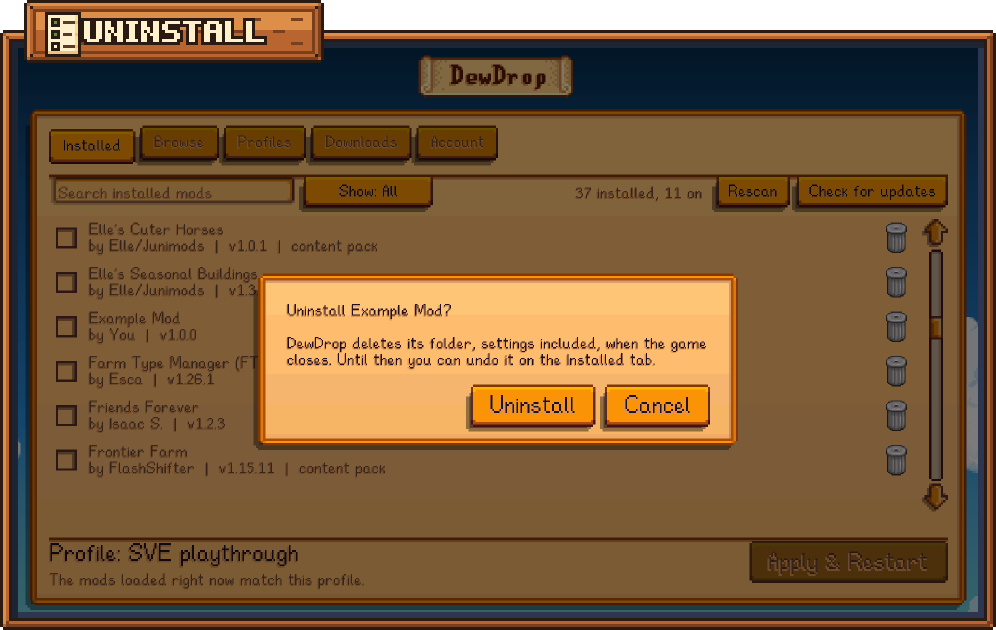

# Managing your mods

The **Installed** tab lists every mod in your `Mods` folder, sorted by name. A tick means the mod is on in your active profile. The menu always opens on this tab.

<figure><figcaption>
The Installed tab.
</figcaption></figure>

## Turn a mod on or off

1. Click anywhere on the mod's row. The checkbox ticks or unticks.
2. Do the same for any other mods you want to change.
3. Click **Apply & Restart** in the bottom-right corner to restart the game with your changes.

DewDrop saves each change to your profile straight away. Turning a mod off deletes nothing: its folder stays, and you can turn it back on any time. To get rid of a mod, [uninstall it](#uninstall-a-mod).

When you turn a mod on, DewDrop also turns on the installed mods it needs, and says so: "Also turned on what it needs: Content Patcher".

DewDrop itself always stays on. Clicking its row says "DewDrop has to stay on so this menu is here next time."


Changes load the next time the game starts in your profile: after **Apply & Restart**, or from Steam's **Play** button with **Start in my profile from Steam** on. A desktop shortcut, for example, loads every mod in your `Mods` folder, including the ones you turned off, and DewDrop then offers on the title screen to restart into your profile. See [How launching works](../getting-started/launching.md) and [Start in your profile](start-in-your-profile.md).


## Find a mod

**Search.** Type in the **Search installed mods** box. The list filters as you type, matching a mod's name, author or unique ID. Capital letters don't matter.

**Filter.** Click the **Show:** button to step through these views. The search and the filter work together.

| Button | Shows |
| --- | --- |
| **Show: All** | Every installed mod. |
| **Show: Enabled** | Mods that are on in your profile. |
| **Show: Disabled** | Mods that are off. |
| **Show: Updates** | Mods with a new update you haven't downloaded yet. |
| **Show: Problems** | Mods that are on but need a mod that's missing or off, and mods [installed twice](#mods-installed-twice). |

After **Show: Problems**, the next click goes back to **Show: All**. If nothing matches, the list says "No mods match."

When there's room, the toolbar shows a count, such as "42 installed, 30 on". While uninstalled mods wait to be deleted, it adds them: "36 installed, 11 on, 1 to delete".

## Read a mod's row

Each row has:

* **A checkbox.** Ticked means on. It's dimmed when you can't change it: on DewDrop's own row, and on every row when the profile is read-only or its file couldn't be read.
* **The name**, grayed out when the mod is off.
* **A details line**, such as "by Pathoschild | v2.5.3". It adds "content pack" for a mod that adds content through another mod, and "collection" for a copy Stardrop installed from a Nexus collection.
* **A status note** on the right, when there's something to know (see below).
* **An Update button** when there's a new version (see [Updates](#updates)).
* **A trash can** at the right edge, the one from the game's inventory, to [uninstall the mod](#uninstall-a-mod). Its lid tips open when you point at it. DewDrop's row and collection copies don't have one.

Point at a row to see the mod's description, unique ID, folder, and which mod it's a content pack for.

### Status notes

| Note | What it means |
| --- | --- |
| **Update ready, restart to finish** (green) | An update is downloaded, but the game is still using the old files. It goes in with **Apply & Restart**, or on Windows when you quit. See [Updating mods](updating-mods.md#finish-the-update). |
| **Installed twice** (red) | Two folders hold this mod. See [Mods installed twice](#mods-installed-twice). |
| **Needs** and names (red) | The mod is on, but something it requires is missing or off. See [Missing requirements](#missing-requirements). |
| **Off after restart** (orange) | The mod is loaded now but off in your profile, so it won't load the next time the game starts in your profile. |
| **On after restart** (orange) | The mod is on in your profile but isn't loaded yet, for example because you turned it on after the game started. It loads the next time the game starts in your profile. |
| **Deleted when the game closes** (orange) | You uninstalled the mod. See [Until the game closes](#until-the-game-closes). |

If the game started in your profile and SMAPI skipped a mod anyway (a broken one, or one that needs a newer SMAPI), its row also says **On after restart**, but restarting won't load it. The SMAPI log says why.

While the bottom bar shows a red problem, the two "after restart" notes are hidden.

## Missing requirements

Many mods need another mod to work, such as a framework like Content Patcher. When a mod that's on is missing one, its row says **Needs** and what's missing. **Show: Problems** lists all of them.

* **A mod's name** means you have that mod but it's off. Click its row to turn it on.
* **A unique ID** (like `Pathoschild.ContentPatcher`) means it isn't installed. Find it on the [Browse](browse.md) tab and install it.

DewDrop doesn't download required mods for you. The mod's Nexus page usually lists what it needs.

## Updates

DewDrop checks for updates each time the game starts, and when you click **Check for updates**. A mod with a new version gets a green button such as **Update to 1.4.0**, and the tab reads **Installed (1 new)**. With Premium, clicking it installs the update in the game; with a free account, it opens the file on the Nexus Mods website. See [Updating mods](updating-mods.md).

## Uninstall a mod

Uninstalling deletes the mod's folder from your `Mods` folder, settings included. DewDrop waits until the game closes to delete it, so you can change your mind until then.

1. Click the trash can at the right edge of the mod's row. Pointing at it says "Uninstall *name*. Its folder is deleted when the game closes."
2. A dialog asks "Uninstall *name*?" and says what will happen.
3. Click **Uninstall**, or press **Enter**. To keep the mod, click **Cancel**.

A message confirms it: "Uninstalled *name*. It's deleted when the game closes."

<figure><figcaption>
The dialog that opens when you click a mod's trash can.
</figcaption></figure>

The dialog starts with one of these:

* "DewDrop turns it off now and deletes its folder, settings included, when the game closes. Until then you can undo it on the Installed tab." The mod is on in your profile.
* "DewDrop deletes its folder, settings included, when the game closes. Until then you can undo it on the Installed tab." The mod is off already, or your profile stays as it is (see [What happens to your profiles](#what-happens-to-your-profiles)).

Then it adds any of these that apply:

| Line | When you see it |
| --- | --- |
| "*names* need it and won't work without it." | Mods that are on in your profile require this one, and no other copy of it is left. |
| "The update downloaded for it is thrown away too." | The mod has an update waiting (**Update ready, restart to finish**). |
| "*name* came with SMAPI, so installing SMAPI again puts it back." | It's one of SMAPI's own small mods, **Console Commands** or **Save Backup**. |
| "Your other copy, in the '*folder*' folder, stays installed." | The mod is [installed twice](#mods-installed-twice). |

### Until the game closes

The mod's row stays on the list, so you can change your mind:

* It has no checkbox, its name is grayed out, and it says **Deleted when the game closes** next to an **Undo** button.
* It stays in every **Show:** view, and in a search that matches it.
* Clicking the row only reminds you: "*name* is uninstalled. Click Undo to keep it."

<figure><figcaption>
An uninstalled mod stays on the list, with Undo, until the game closes.
</figcaption></figure>

Everywhere else, DewDrop treats the mod as gone: Browse and the mod's page no longer show it as installed.

If the game is still running the mod, the bottom bar says "*name*, which you uninstalled, is still loaded. Restart to finish uninstalling." and **Apply & Restart** lights up. Otherwise it says "The mods loaded right now match this profile. Uninstalled mods are deleted when the game closes." See [The bottom bar](the-menu.md#the-bottom-bar).

### Undo

Click **Undo** on the row to keep the mod. If uninstalling turned it off, Undo turns it back on in that profile, even if you've switched profiles since. A message says what happened:

* "Kept *name*."
* "Kept *name* and turned it back on."
* "Kept *name* and turned it back on in the '*profile*' profile." You've switched to another profile since.
* "Kept *name*. Turn it back on yourself: the '*profile*' profile can't be changed now." For example, that profile was deleted or renamed, or its file couldn't be read.
* "*name* was already deleted." (red) It's too late to keep that copy.

Installing the same mod again before the game closes, for example from its page on **Browse**, also cancels the uninstall.

### When the folder is deleted

The game may still be using the mod's files, so DewDrop moves the folder out of your `Mods` folder when the game closes, whether you quit or click **Apply & Restart**, and deletes it the next time the game starts.

* **On Windows, a file can stay open.** DewDrop then tries again a moment after the game has closed, and at each start. After three starts it gives up: "Couldn't delete '*folder*' (uninstalled): a file stayed open. Delete it yourself." The SMAPI log has the full path. Close the game and anything that might be using the folder, then delete it. Until you do, it's listed as an ordinary mod again.
* **If the game crashes,** DewDrop deletes the folder at the next start instead, unless that session loads the mod again; then it waits for that session to close. Until then the row still has **Undo**, but Undo can't turn the mod back on, so tick it yourself afterwards.

[How DewDrop works](../reference/how-it-works.md#uninstalling-a-mod) has the details.

### What happens to your profiles

* Uninstalling turns the mod off only in your active profile. Other profiles still list it, which does no harm once it's gone.
* It doesn't turn the mod off at all when another copy of it stays in your `Mods` folder, or when your active profile is read-only.
* If you use Stardrop's profile-specific mod configs, the settings Stardrop saved for the mod stay as they are.

### When you can't uninstall

DewDrop's own row has no trash can: to remove DewDrop, see [Uninstalling DewDrop](../getting-started/uninstalling.md). Copies from a Stardrop collection have none either, because the collection owns them: remove the collection in Stardrop.

When a mod can't be uninstalled right now, pointing at its trash can says why, and clicking it shows the same message:

| Message | What to do |
| --- | --- |
| "Wait for *title* to finish installing, then try again." | DewDrop is installing a download. Wait until the [Downloads](downloads.md) tab no longer says **Installing...**. |
| "*name* is downloading again. Cancel that on the Downloads tab, or wait for it." | A download of this mod is queued or running. Cancel it on the **Downloads** tab, or let it finish. |
| "*name* is already uninstalled." | It's waiting to be deleted. Use **Undo** on its row to keep it. |
| "DewDrop won't delete the '*folder*' folder: it isn't a mod inside your Mods folder." | The folder holds something DewDrop must keep, such as DewDrop itself, or it isn't a mod's own folder inside `Mods` (its `manifest.json` is gone, say). Close the game and remove what you don't want by hand. |

## Mods installed twice

If two folders in your `Mods` folder hold the same mod, with the same unique ID, both rows say **Installed twice** in red, and **Show: Problems** lists them. When SMAPI loads your `Mods` folder directly, as a normal launch does, it loads neither copy.

On Linux, including the Steam Deck, folder names that differ only in capital letters, such as `Spacecore` and `SpaceCore`, are two separate folders. Unzipping a newer version next to an old one can leave you with both, and DewDrop treats them as two copies, just as SMAPI does.

Point at one of the rows to see where the other copy is, such as "Also installed in: ContentPatcher (v2.5.3)". Then click the trash can on the copy you don't want. The dialog says "Your other copy, in the '*folder*' folder, stays installed.", and the mod stays on in your profile.

## Added or removed a mod by hand?

DewDrop looks through your `Mods` folder each time the game starts. A mod you copied in while the game was closed is turned **on** in your active profile then, as long as **Turn on mods when installed** is on (the default). The next time you open the menu, a message lists them: "Turned on *mods*, new in your Mods folder."

If you copy a mod in, or delete one, while the game is running, click **Rescan**. New mods are turned on the same way, and a message says what changed:

* "Found 1 new mod: *name*. Restart to load it."
* "Found 1 new mod: *name*. Turn it on, then restart to load it." The new mod is still off, for example because **Turn on mods when installed** is off.
* "1 mod is no longer in your Mods folder: *name*."
* "No changes: your Mods folder has the same mods as before."

Good to know:

* Only mods DewDrop has never seen are turned on. A mod you've turned on or off before keeps your choice, even if you move it or extract it again.
* With **Turn on mods when installed** off, new mods stay off until you tick them. Until then they won't load when the game starts in your profile.
* Mods from Stardrop collections are never turned on this way, and collection profiles never change.
* **Rescan** waits while DewDrop is installing something: "*title* is still installing. Rescan when it's done."
* DewDrop finds mods in sub-folders of `Mods` too. Like SMAPI, it skips folders whose names start with a dot, so renaming a folder to `.MyMod` hides it from both.

## Collection profiles

If your active profile came from a Nexus collection in Stardrop, it's read-only. The tab says "This collection profile is read-only. Duplicate it on the Profiles tab to change it." To choose which mods are on, make a copy on the [Profiles](profiles.md) tab and use the copy.

## What the Installed tab can't do yet

* **Install a mod from a file you downloaded.** Unzip it into your `Mods` folder yourself, then click **Rescan**. See [Added or removed a mod by hand?](#added-or-removed-a-mod-by-hand)
* **Sort the list.** It's always sorted by name.
