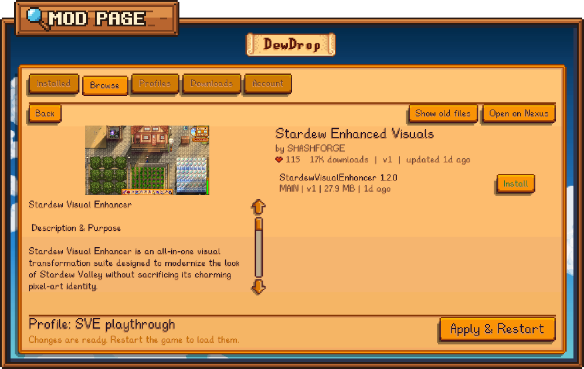
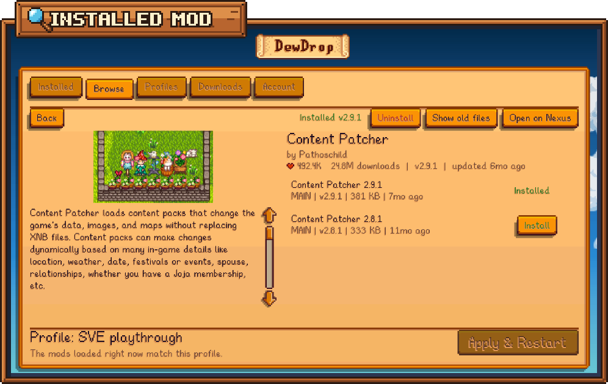

# A mod's page and installing files

Click any card on the [Browse](browse.md) tab to open that mod's page. It shows the mod's picture and description, and lists its files, each with its own install button.

<figure><figcaption><p>A mod's page, opened from Browse.</p></figcaption></figure>

## What's on the page

**Along the top:**

* **Back** returns to your search results. **Backspace** does the same.
* **Installed v1.2.0**, in green, when you already have the mod. Next to it, **Update available: v1.3.0** (orange) means there's a newer version, and **Update ready, restart to finish** (green) means an update is downloaded and waiting. In a narrow window, these two shorten to **Update: v1.3.0** and **Restart to update**. DewDrop recognizes your copy the same ways as the **Installed** tag on Browse; see [How DewDrop knows you have a mod](browse.md#how-dewdrop-knows-you-have-a-mod).
* **Uninstall**, in red, when you have copies of this mod that DewDrop can match to the page. See [Uninstall from a mod's page](#uninstall-from-a-mods-page).
* **Show old files**, when the mod has older versions. Click it to list them, and **Hide old files** to hide them again.
* **Open on Nexus** opens the mod's page on the Nexus Mods website. On a Steam Deck in Game Mode, it opens in Steam's overlay.

**On the left:** the mod's picture and description. The description is plain text, so the website's images and formatting aren't shown; **Open on Nexus** has the full page. Scroll it with **Up** and **Down**, or with the mouse wheel while the pointer is over it.

**On the right:** the mod's name and author, then a heart with endorsements, the download count, the latest version and when it was last updated.

**The file list** is under that. Each file shows its name and a line like "MAIN | v1.3.0 | 2.4 MB | 3d ago": its category, version, size and age. Point at a file to read the author's note about it. If the list says "No current files.", click **Show old files**.

## Which file do I want?

Most mods have one **MAIN** file, and that's usually the one to install. **OPTIONAL** files are extras you can add. Some mods offer several main files as alternatives, such as different styles of the same thing. Read the description before you pick one of those.

The description also lists what else the mod needs, such as a framework like Content Patcher. DewDrop doesn't download those for you.

## The Install button

Every file has a button on its right. What it says depends on your Nexus Mods account, and on whether you already have the file or it's already downloading.

| Button | When you see it | What clicking does |
| --- | --- | --- |
| **Log in to install** | You're not logged in to Nexus Mods. | Takes you to the **Account** tab. See [Connecting your Nexus account](../nexus-mods/connecting.md). |
| **Install** (green) | You have Nexus Mods Premium. | Downloads and installs the file in the game. |
| **Get on Nexus** | You have a free Nexus Mods account. | Opens the file on the Nexus Mods website, where you click **Slow download**. |
| **Queued...**, **Downloading 42%** or **Installing...** (grayed out) | DewDrop is already getting this file. | Nothing. Progress is also on the [Downloads](downloads.md) tab. |
| **Installed** (green text, no button) | You already have this file, whatever your account. | Nothing. Pointing at it says "You have this file. To install it again, uninstall it first." |

Why the difference? Nexus Mods only lets Premium members download straight into an app. Free accounts download through the website. [Free vs Premium downloads](../nexus-mods/free-vs-premium.md) explains it.

<figure><figcaption><p>A mod you already have: its file says Installed, and Uninstall is in the top bar.</p></figcaption></figure>

### Which file counts as installed

DewDrop marks at most one file for each copy of the mod in your `Mods` folder:

* **The file DewDrop installed it from,** as long as you still have that version.
* **Otherwise, the one file whose version matches your copy,** or the single **MAIN** one if several do. If it still can't tell, it marks none rather than guess.

An update that's downloaded and waiting for a restart counts as installed. If you uninstalled one part of what a file installed, that file isn't marked, so you can install it again to put the part back.

A Premium install of a file DewDrop's install record says you have doesn't download it again: DewDrop says "*title* is already installed." "Mod manager download" links from the website still install it, as a reinstall.

## Install a file with Premium

1. Click the green **Install** button next to the file.
2. The button counts up (**Downloading 42%**), then reads **Installing...**. You can keep browsing while it works.
3. When it's done, a message such as "Some Mod 1.3.0: Installed 1 mod. Restart to load it." appears.
4. Click **Apply & Restart** to load the new mod.

DewDrop turns new mods on in your profile for you, unless the profile is a read-only collection profile. **Turn on mods when installed** in [Settings](settings.md) controls this.

## Install a file with a free account



First, let the website send files to DewDrop. You only do this once: on the **Account** tab, click **Use DewDrop for these links** in the **Mod manager links** panel, then **Use DewDrop** to confirm. See ["Mod manager download" links](../nexus-mods/mod-manager-links.md).

1. Click **Get on Nexus** next to the file. The file opens on the Nexus Mods website in your browser, and DewDrop says "Click 'Slow download' on the website; DewDrop installs it when it arrives."
2. On the website, click **Slow download**.
3. If your browser asks whether to open the link, allow it.
4. Go back to the game. Within a few seconds, the download starts on the **Downloads** tab.
5. When it says the mod is installed, click **Apply & Restart**.

If the links aren't set up yet, **Get on Nexus** still opens the website, but DewDrop shows a red message such as "Turn on mod manager links on the Account tab first, then click 'Slow download'."



The website can't send files back to DewDrop on these systems yet: its "Mod manager download" links only reach DewDrop on Windows. **Get on Nexus** still opens the file on the website, and DewDrop says "Opened the file on Nexus Mods. Mod manager links only work on Windows for now, so add the mod to your Mods folder yourself."

What you can do instead:

* **Install it by hand.** Download the file from the website, unzip it into your `Mods` folder, then click **Rescan** on the [Installed](installed.md) tab, tick the mod if it's off, and click **Apply & Restart**. On a Steam Deck, copying files needs Desktop Mode.
* **Use the SMAPI console** (macOS and Linux without DewDrop's Steam launcher). Copy the `nxm://` link the website opens, then type this in the SMAPI console window, with the link in place of `<link>`:

  ```text
  dewdrop_nxm <link>
  ```

  On a Steam Deck, or on Linux with DewDrop's Steam launcher, there's no console window to type in.

[Free accounts on macOS and Linux](../nexus-mods/free-vs-premium.md#free-accounts-on-macos-and-linux) has the details for both.



## What gets installed

* DewDrop opens `.zip`, `.7z` and `.rar` downloads, unpacks them into your `Mods` folder, then deletes the downloaded file.
* Every folder in the download that has a `manifest.json` is installed as its own mod. A mod folder inside another mod's folder stays part of that mod.
* A new mod never overwrites another mod's folder. If the name is taken, it gets a name like `Name (2)`.
* **If you already have the mod,** DewDrop updates it in its existing folder and keeps your `config.json` settings. See [Updating mods](updating-mods.md).
* **If the game is using the old files,** the message says "Update ready, finishes when the game restarts". The new version goes in when you use **Apply & Restart**, or when you quit the game.
* **If the download holds several alternative versions of one mod,** DewDrop updates the one you already have, if it can match it by folder or name. Otherwise it installs none and says so. Download the file from the website and copy the version you want into your `Mods` folder.
* **If you uninstalled the mod and the game hasn't closed yet,** installing it again puts it back and cancels the uninstall.


Everything you install loads after a restart, and the bottom bar reminds you until then. Install everything you want first, then click **Apply & Restart** once. If a mod is still installing, DewDrop asks you to restart when it's done. The restart cancels downloads that haven't finished, and its dialog warns you first.


## Uninstall from a mod's page

When you have copies of the mod that DewDrop can match to its page, a red **Uninstall** button appears in the top bar. It finds them the same ways as the **Installed v1.2.0** note. Copies from Stardrop collections, and DewDrop itself, are never included.

1. Click **Uninstall**. Pointing at it first says which mods it uninstalls.
2. With one mod, the dialog is the same as on the **Installed** tab. When DewDrop matches several of your mods to the page, such as a mod and its content packs, it asks about all of them at once, for example "Uninstall Some Mod? That's 3 mods: A, B and C."
3. Click **Uninstall** to confirm, or **Cancel** to keep them.

Each mod's folder is deleted when the game closes. Until then you can undo it on the **Installed** tab, one mod at a time. See [Uninstall a mod](installed.md#uninstall-a-mod).


Check the names in the dialog. DewDrop only uninstalls the parts it can match to this page. If you installed the mod by hand and some of its parts have no Nexus update key, the list may leave them out. Remove those on the **Installed** tab.


## Leaving the page

* Click **Back** or press **Backspace** to return to the cards. Your page of results and scroll position are kept.
* If you switch to another tab, the mod's page is still open when you come back to **Browse**.

Nexus collections can't be installed from DewDrop. Use [Stardrop](../stardrop.md) for those.
