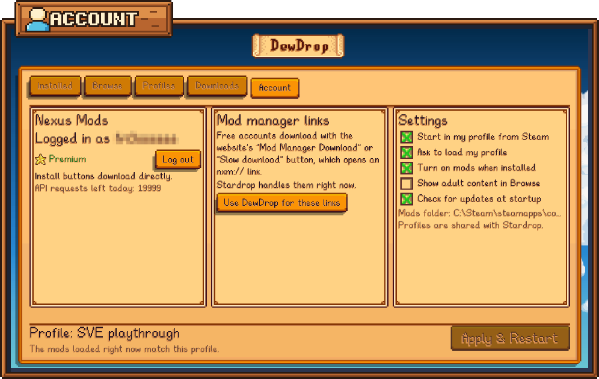

# Settings

DewDrop's options are on the **Account** tab, in the **Settings** panel on the right. Each option is a checkbox: click anywhere on its row to tick or untick it. Your choice is saved straight away.

The other two panels on the **Account** tab are for your Nexus Mods login and for website download links. See [Connecting your Nexus account](../nexus-mods/connecting.md) and ["Mod manager download" links](../nexus-mods/mod-manager-links.md).

<figure><figcaption><p>The Settings panel is on the right of the Account tab.</p></figcaption></figure>

## The options

| Option | What it does | Default |
| --- | --- | --- |
| **Start in my profile from Steam** | Steam's **Play** button starts the game straight in your profile, so you don't need **Apply & Restart**. Steam version only; on Linux and the Steam Deck, with DewDrop's Steam launcher. | Off |
| **Ask to load my profile** | When the game starts with different mods than your profile, for example from a desktop shortcut, a **Load your profile?** box on the title screen offers to restart into it. | On |
| **Turn on mods when installed** | Mods you download through DewDrop, and new mods you copy into your `Mods` folder yourself, are switched on in your active profile. | On |
| **Show adult content in Browse** | Browse includes mods that Nexus Mods marks as adult content. | Off |
| **Check for updates at startup** | DewDrop looks for new versions of your mods each time the game starts. | On |

Hover over a row to see its description. A grayed-out row can't be changed here, and hovering over it tells you why.

### Start in my profile from Steam

Normally, pressing **Play** in Steam loads everything in your `Mods` folder, and it takes a restart to switch into your profile. With this option on, Steam starts the game straight in your profile instead. On Windows, DewDrop does this by adding SMAPI's `--mods-path` option to Stardew Valley's launch options in Steam, pointing at `Selected Mods`, the folder DewDrop fills with links to your profile's mods. On Linux and the Steam Deck, Steam's launch option runs DewDrop's Steam launcher instead, which the installer sets up, and the launcher starts SMAPI on `Selected Mods` while this option is on.

On Windows, Steam has to be closed to change its launch options, so the change happens **when you quit the game**. A few seconds after the game closes, Steam closes, the launch option changes, and Steam opens again, minimized to the system tray. This happens once each time you switch the option on or off. The next time you open **Mods**, a message says "Steam now starts the game in your profile." or "Steam no longer starts the game in your profile." With DewDrop's Steam launcher, Steam never closes: the change takes effect at once, with no message.

While it's on, DewDrop links your changes as you quit the game: mods you turned on or off, a profile you switched to, and mods you installed. They load the next time you press **Play** in Steam. [**Apply & Restart**](apply-and-restart.md) still loads them right away.

The row's description follows what's happening. On Windows:

| State | Description |
| --- | --- |
| Off | "Have Steam start the game in your profile, so you don't need Apply & Restart. Steam closes and opens again once when you quit, to save it." |
| Turning on | "Turns on when you quit the game: Steam closes and opens again once to save it. After that, Steam starts the game in your profile." |
| On | "Steam starts the game in your profile. Changes you make load the next time you start it." |
| Turning off | "Turns off when you quit the game: Steam closes and opens again once to save it." |

With DewDrop's Steam launcher, there's nothing to wait for, so the row says "Have Steam start the game in your profile, so you don't need Apply & Restart." while it's off, and the On text while it's on.

The row is grayed out when the option can't be used: on macOS, on Linux and the Steam Deck until the installer has set up DewDrop's Steam launcher (on Linux, run it with `--steam-setup`), when the game runs through Proton or Wine, for the GOG or Xbox app version of the game, when DewDrop can't find Steam or your Steam account's settings, when DewDrop's Steam launcher couldn't be updated, and on Windows when Stardew Valley's launch option in Steam starts some other program than SMAPI.

* **Only Steam's Play button starts in your profile.** A desktop shortcut, or starting `StardewModdingAPI.exe` yourself, still loads the whole `Mods` folder. **Ask to load my profile** covers those launches.
* **Until you choose, the row follows Steam.** If Steam's launch option already points at `Selected Mods`, for example because you added it yourself, the row shows as ticked and DewDrop leaves the option alone. With DewDrop's Steam launcher, it follows what you told the installer.
* **The installer asks about it too,** when it sets up Steam's launch option. On Windows it saves your answer here; on Linux and the Steam Deck, the game picks it up at its next start. On Linux and the Steam Deck, it doesn't ask again once the option is on, or once you've turned it off in the game: it keeps that.
* **Before you uninstall DewDrop** on Windows, untick this row and quit the game. Otherwise SMAPI keeps loading your last profile, with no **Mods** button to change it.

See [Start in your profile](start-in-your-profile.md) for the whole feature.

### Ask to load my profile

When the game starts on your whole `Mods` folder, for example from a desktop shortcut, from Steam with **Start in my profile from Steam** off, or on macOS, DewDrop compares the mods that loaded with your profile. If they're different, a **Load your profile?** box on the title screen names the mods and offers to restart into your profile. Untick this row to stop the box. You can still use [**Apply & Restart**](apply-and-restart.md) whenever you like.

* If every mod in your `Mods` folder is on in your profile, the mods already match and nothing appears.
* **Don't ask again** in the box unticks this row.
* A change here applies from the next time you start the game.
* When the game runs through Proton or Wine, the box never appears, whatever this row says.

See [Start in your profile](start-in-your-profile.md) for what the box says and what each button does.

### Turn on mods when installed

When this is on, every mod DewDrop installs is ticked in your active profile, along with any installed mods it needs. Click [**Apply & Restart**](apply-and-restart.md) to load them.

* It covers updates too. Updating a mod that was off in your profile turns it on.
* It covers mods you copy into your `Mods` folder yourself. DewDrop turns them on when the game starts, or when you click **Rescan** on the [Installed tab](installed.md). Only mods DewDrop has never seen before count, so a mod you turned off stays off.
* It doesn't change collection profiles, which are read-only, or a profile whose file couldn't be read.

When it's off, new mods stay off until you tick them on the [Installed tab](installed.md).

### Show adult content in Browse

When you change this, [Browse](browse.md) reloads its results the next time you open it.

### Check for updates at startup

DewDrop asks smapi.io for updates in the background as the game starts. If it finds any, the **Installed** tab shows a count, such as **Installed (2 new)**. The same check tells DewDrop which Nexus mod some of your mods are, which helps Browse [mark the mods you have](browse.md#how-dewdrop-knows-you-have-a-mod). If you turn this off, the change applies from your next launch, and you can still click **Check for updates** on the **Installed** tab whenever you like. See [Updating mods](updating-mods.md).

## The lines under the options

* **Mods folder:** the folder DewDrop installs new mods into. This is usually your game's `Mods` folder. If you use Stardrop, it's the install folder set in Stardrop.
* "Profiles are shared with Stardrop." See [Profiles](profiles.md) and [Using DewDrop with Stardrop](../stardrop.md).
* "This session started outside DewDrop's profile folder." (orange) means the game didn't start in your profile, for example because you started it from a desktop shortcut. The line under **Profile:** at the bottom of the menu says whether the mods that loaded match your profile. See [How launching works](../getting-started/launching.md) and [Start in your profile](start-in-your-profile.md).

## Where settings are saved

The five options are saved in `config.json` in DewDrop's own mod folder, usually `Stardew Valley/Mods/DewDrop/config.json`. SMAPI creates the file the first time DewDrop runs.


```json
{
  "ShowAdultContent": false,
  "EnableModsOnInstall": true,
  "CheckUpdatesOnLaunch": true,
  "StartInProfileFromSteam": null,
  "AskToLoadProfile": true,
  "NexusSsoSlug": ""
}
```


| Option in the menu | Key in `config.json` |
| --- | --- |
| **Start in my profile from Steam** | `StartInProfileFromSteam`: `true` or `false`, or `null` before it's set |
| **Ask to load my profile** | `AskToLoadProfile` |
| **Turn on mods when installed** | `EnableModsOnInstall` |
| **Show adult content in Browse** | `ShowAdultContent` |
| **Check for updates at startup** | `CheckUpdatesOnLaunch` |

`NexusSsoSlug` has no switch in the menu. It's reserved for a browser login that isn't available yet, so leave it empty. Every key is described in [config.json options](../reference/config.md).


To edit `config.json` by hand, close the game first. DewDrop reads the file once when the game starts, and clicking an option in the menu writes the whole file again.


The installer and the manual update steps both keep your `config.json` when you update DewDrop. See [Updating DewDrop](../getting-started/updating-dewdrop.md).

### What isn't in config.json

The path of your `Mods` folder, your active profile and your Nexus Mods login are saved in Stardrop's `Settings.json`, which DewDrop and Stardrop share. DewDrop has no option to change that path. See [Where DewDrop keeps files](../reference/file-locations.md).
