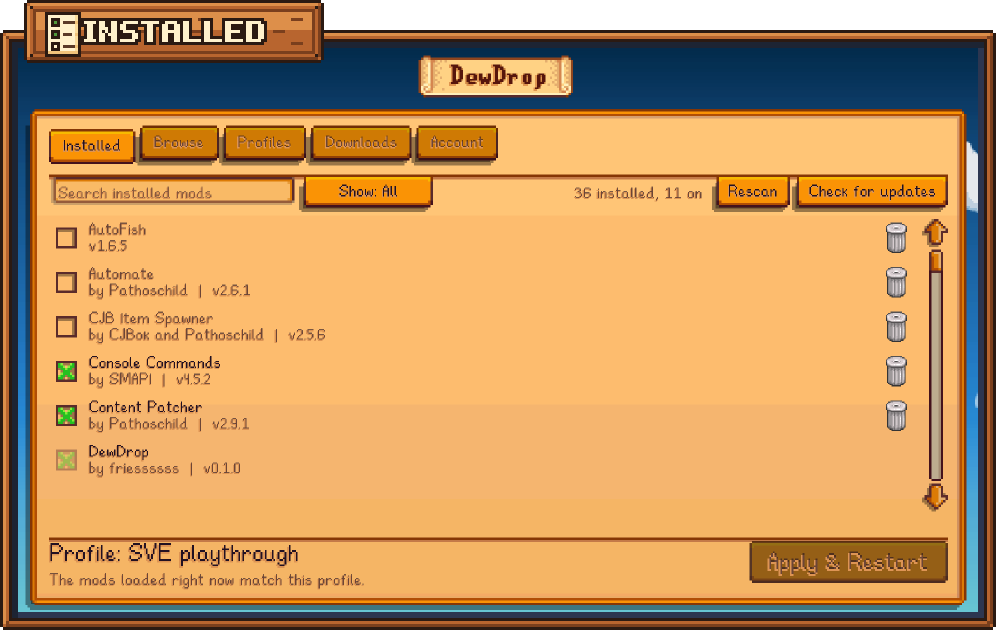

# Updating mods

DewDrop checks for new versions of your mods and puts an **Update to** button on each mod that has one. With a Nexus Mods account, it can download and install most updates for you.

## How DewDrop finds updates

DewDrop asks smapi.io, the same update service SMAPI itself uses. It checks:

* when the game starts, if **Check for updates at startup** is on. It's on by default; see [Settings](settings.md).
* when you click **Check for updates** on the **Installed** tab. The button reads **Checking...** while it works, then a message says "Everything's up to date." or how many updates are available.

A mod can only be checked if its author said where its updates are published (its "update keys") and gave it a normal version number such as `1.2.3`. Mods from Stardrop collections are never checked, because the collection decides their version. DewDrop checks itself the same way; see [Updating DewDrop](../getting-started/updating-dewdrop.md).

The same check also asks smapi.io about mods without update keys, only to learn which Nexus mod each one is. That's one way [Browse](browse.md#how-dewdrop-knows-you-have-a-mod) knows you have a mod. Those mods still aren't offered updates.

DewDrop sends smapi.io only each mod's ID, version and update keys, plus your SMAPI version, game version and operating system. Nothing about your Nexus Mods account is sent. If a check you started fails, a red message says why, such as "Couldn't reach smapi.io to check for updates." Check your internet connection and try again later.

## See which mods have updates

<figure><figcaption>
Updates show on the Installed tab.
</figcaption></figure>

* The **Installed** tab shows a count, for example **Installed (2 new)**.
* **Show: Updates** lists only those mods. Click the filter button until it reads that.
* Each of them has a green **Update to** button with the new version, for example **Update to 2.1.0**.
* On Browse, the mod's card has an orange **Update** tag instead of **Installed**.
* On the mod's page, the top bar shows **Update available:** and the new version next to the one you have.

## Install an update

Click the mod's **Update to** button. What happens next depends on your Nexus Mods account. To log in, see [Connecting your Nexus account](../nexus-mods/connecting.md).



1. A message says "Finding the *mod* update...".
2. DewDrop picks the file for the new version from the mod's Nexus Mods page, downloads it and installs it. You can follow it on the [Downloads](downloads.md) tab.
3. When it's done, click **Apply & Restart** to load the new version. See [Finish the update](#finish-the-update).



Free accounts download from the Nexus Mods website. On Windows, DewDrop picks that download up once it handles the website's "Mod manager download" links (a one-time setup; see ["Mod manager download" links](../nexus-mods/mod-manager-links.md)).

1. Click **Update to**. The new file opens on the Nexus Mods website.
2. On the website, click **Slow download**. If your browser asks whether to open the link, allow it.
3. Within a second or so, the download appears on DewDrop's [Downloads](downloads.md) tab, and DewDrop installs it.
4. Click **Apply & Restart** to load the new version.

On macOS and Linux, including the Steam Deck, the website's download can't reach DewDrop, and DewDrop's message says so. Download the file yourself and [update the mod by hand](#update-a-mod-by-hand), or see the other options in [Install a file with a free account](mod-page.md#install-a-file-with-a-free-account).



DewDrop opens the update's page in your browser. If the mod is on Nexus Mods, a message also says "Log in to Nexus Mods on the Account tab to update in-game."

Log in and click **Update to** again, or download the file yourself and [update the mod by hand](#update-a-mod-by-hand).



Some updates aren't on Nexus Mods, for example a release on GitHub. DewDrop then opens that page instead. If the mod also has a Nexus Mods page, a message says "The *mod* update isn't on Nexus Mods; opening where it is." If DewDrop can't tell which Nexus file is the new version, it says "Couldn't find *mod* *version* among its Nexus files; opening them instead." Either way, download the file yourself and [update the mod by hand](#update-a-mod-by-hand).

## Finish the update

Some updates go in straight away, and the download says **Updated**: content packs (mods made only of files, with no code), mods the game hasn't loaded, and most updates on macOS and Linux. Either way, the new version only loads after a restart.

On Windows, the game keeps a loaded mod's files open, so DewDrop usually can't replace a mod you're playing with. It keeps the new version ready instead. The mod's row on the **Installed** tab says **Update ready, restart to finish**, and the download says "Update ready, finishes when the game restarts". The update goes in once the game has closed, in either of these ways:

* **Apply & Restart.** DewDrop swaps in the new version after the game closes and before it starts again. See [Apply & Restart](apply-and-restart.md).
* **Quitting the game.** A moment after the game closes, DewDrop swaps in the new version. It loads the next time you start the game.

If an update still can't go in, for example because another program has one of its files open, it keeps waiting and DewDrop tries again next time. Nothing is lost: the note stays until the update is in. The one exception: if you [uninstall the mod](installed.md#uninstall-a-mod) while its update waits, the update is thrown away with it.

### What the update keeps

DewDrop copies every `config.json` from the old version into the new one, so your settings for the mod stay. It also keeps files the new version doesn't come with in the mod's `data` folder and `.json` files at the top of the mod folder, where many mods keep per-save data. Everything else comes from the new version.

If **Turn on mods when installed** is on (the default), updating a mod that was off in your active profile turns it on.

## Update a mod by hand

1. Close the game.
2. Download the new version of the mod.
3. In your `Mods` folder, replace the mod's old folder with the new one. To keep your settings for that mod, copy its old `config.json` into the new folder.
4. Start the game. Your profiles remember mods by their ID, so the mod stays on wherever it was on.
