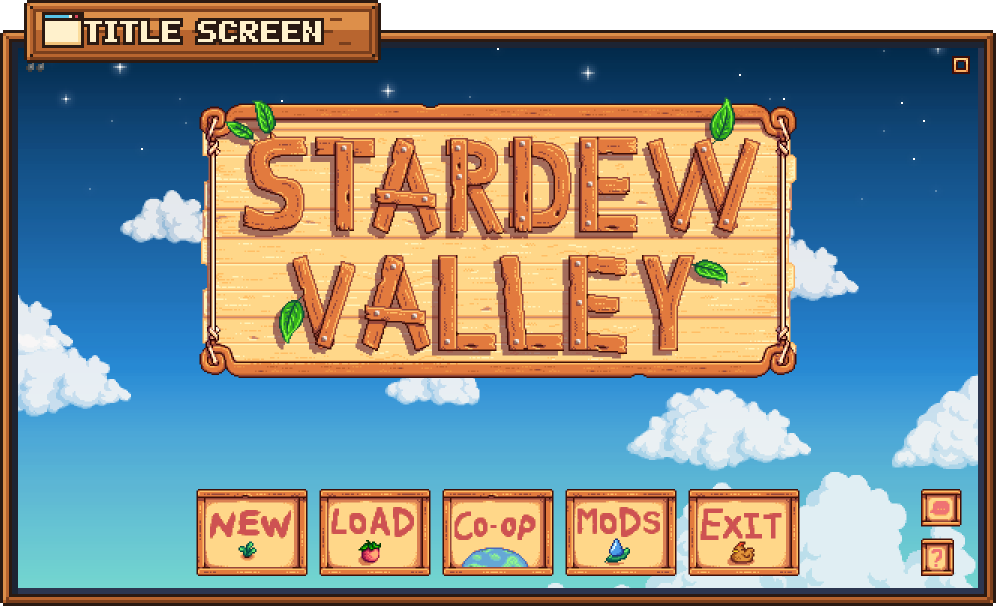
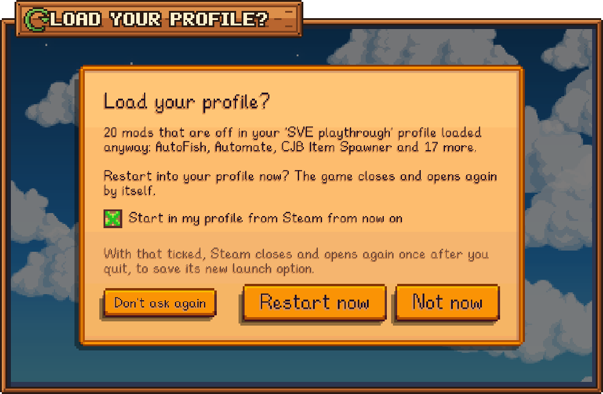
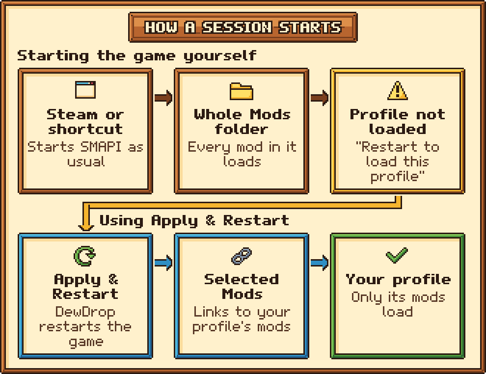

# Troubleshooting

Find what you're seeing in this list and click it. If nothing here helps, see [Reporting issues](reporting-issues.md) for how to get help.

**While installing**

* [Windows said "Windows protected your PC"](#the-installer-fails-to-start)
* [macOS says the installer can't be opened](#the-installer-fails-to-start)
* [The installer window says "Oops!"](#the-installer-fails-to-start)
* [The installer couldn't find my game](#the-installer-cant-find-stardew-valley)
* [The installer wants to restart as administrator](#windows-wont-let-the-installer-change-files)
* [SMAPI didn't install, or the installer stopped after 3 minutes](#smapi-didnt-install)
* [Linux: the installer says I have the Windows version](#linux-the-windows-version-of-the-game)
* [The installer asked about Steam's launch options, or about starting in my DewDrop profile](#the-installer-and-steams-launch-option)

**While playing**

* [There's no Mods button](#no-mods-button-on-the-title-screen)
* [The game starts without the Mods button when I press Play in Steam](#if-steam-starts-the-game-in-your-profile)
* [No SMAPI window opens, or Steam's Play button starts the game without mods](#check-that-smapi-is-running)
* [The game closed and didn't come back](#the-game-closed-and-never-came-back)
* [Apply & Restart says "Didn't restart"](#didnt-restart-because-dewdrop-couldnt-link-a-mod)
* [Steam closed and opened again by itself](#steam-closed-and-opened-again-by-itself)
* [A message says "Steam's launch option wasn't changed"](#steams-launch-option-wasnt-changed)
* [I can't tick Start in my profile from Steam](#you-cant-tick-start-in-my-profile-from-steam)
* [DewDrop asks to load my profile every time](#dewdrop-asks-to-load-your-profile-every-time)
* [The box says the last restart didn't come back](#the-box-says-the-last-restart-didnt-come-back)
* [I don't see the "Load your profile?" box](#dewdrop-doesnt-ask-to-load-your-profile)
* [The box says "Couldn't load your profile"](#couldnt-load-your-profile)
* [Mods I turned off came back](#mods-you-turned-off-came-back)
* [A mod I added myself is missing or didn't load](#a-mod-you-copied-in-is-missing-or-turned-off)
* [A mod update says "restart to finish"](#an-update-says-restart-to-finish)
* [I can't log in to Nexus Mods, or my downloads never arrive](#nexus-mods-problems)
* [There's a red message at the bottom of the menu](#a-red-message-at-the-bottom-of-the-menu)

## The installer

Yellow `[!]` lines are warnings, and the installer carries on after them. If it has to stop, it says why in a red `[x]` line.

### The installer fails to start



**"Windows protected your PC"**

This is Windows SmartScreen. It shows for new downloads it doesn't recognize yet. Click **More info**, then **Run anyway**.

**"Oops! It looks like you opened this from inside the zip file."**

Right-click `DewDrop-<version>-installer.zip` and choose **Extract All...**. In the folder that opens, open `DewDrop <version> installer` and double-click `Install on Windows.bat`. If you see this after extracting, you extracted into a temporary folder: extract to your Downloads folder or desktop instead.

**"Oops! The installer is missing internal\install.ps1."**

Only part of the zip was extracted, or your antivirus removed a file. Check your antivirus's quarantine list, then download the installer again and extract all of it.

**"Oops! The installer couldn't start (error ...)"**

PowerShell couldn't run the installer script. The reason is usually just above this line.

* **Your antivirus blocked it.** Allow the installer in your antivirus, and try again.
* **Your PC doesn't allow PowerShell scripts** (the message mentions scripts being disabled, a policy or a digital signature). This is common on work and school computers. Try once: delete the extracted folder, right-click the zip, choose **Properties**, tick **Unblock**, click **OK**, and extract again. If it's still blocked, [install DewDrop by hand](../getting-started/installing/manual.md). **Apply & Restart** also uses a small PowerShell script, so it may not work on that PC either.



**macOS says the file can't be opened, or "Not Opened"**

macOS shows this for scripts from the internet that Apple hasn't checked. The simplest way round it is to install from Terminal instead: paste `curl -fsSL https://raw.githubusercontent.com/friessssss/DewDrop/master/install.sh | bash` and press **Return**. Or click **Done** (not **Move to Trash**). Open **System Settings** > **Privacy & Security**, scroll down, click **Open Anyway**, and enter your password. On older macOS, right-click the file, choose **Open**, then click **Open** again.

**"...you do not have appropriate access privileges", or double-clicking does nothing**

Open **Terminal**, type `bash` followed by a space, drag `Install on macOS.command` into the Terminal window, and press **Return**.

The macOS installer hasn't been tested yet. If it gives you trouble, [install DewDrop by hand](../getting-started/installing/manual.md) and please [tell us what happened](reporting-issues.md).



**Double-clicking opens a text editor, or nothing happens**

Some file managers don't run scripts on a double-click. Right-click an empty spot in the `DewDrop <version> installer` folder and choose **Open in Terminal**. Type `bash "Install on Linux.sh"` and press **Enter**. Do the same if you see "Couldn't find a terminal to run the DewDrop installer in."

**"Couldn't unzip SMAPI: install 'unzip' (or python3) and try again."**

Install the `unzip` package with your distribution's package manager, then run the installer again.



### The installer can't find Stardew Valley

If the installer says "I couldn't find Stardew Valley automatically.", it asks you to show it your game folder:

* **Windows:** a folder picker opens. Pick the folder with the Stardew Valley game icon in it (`Stardew Valley.exe`). If you close the picker, paste the folder's path and press **Enter**.
* **macOS:** drag your Stardew Valley app, or its game folder, into the Terminal window and press **Return**.
* **Linux:** type or paste the path of the folder that contains `Stardew Valley.dll` and press **Enter**.

To find your game folder:

* **Steam:** in your library, right-click **Stardew Valley** > **Manage** > **Browse local files**.
* **GOG Galaxy:** open the game's **Manage installation** menu and choose **Show folder**.
* **Xbox app:** it's usually `C:\XboxGames\Stardew Valley\Content`.

If it says "That folder doesn't contain Stardew Valley.dll. Try again.", you picked the wrong folder. `Stardew Valley.dll` sits in the same folder as the game icon, so on Windows, look for the game icon again.

You can also give the installer your game folder on the command line. See [Installer command-line options](../reference/installer-options.md).

### Windows won't let the installer change files

"Windows won't let me change files in ..." usually means the game is in a protected folder such as `Program Files`, where some GOG installs are. "Windows refused access to a file" has the same fix.

* **Answer Y** to "Restart the installer as administrator?", then click **Yes** when Windows asks. A new installer window carries on, and you can close the old one. It still starts Steam and the game as you, and puts the **Stardew Valley (SMAPI)** shortcut on the desktop for every user of the PC.
* **Answered N, or Windows didn't start it?** Close the game, right-click `Install on Windows.bat`, choose **Run as administrator**, and go through the installer again.
* **"That happens even as administrator."** Check that the game folder isn't read-only and that your antivirus isn't blocking it.

### SMAPI didn't install

The installer downloads SMAPI's official installer from GitHub and runs it for you. On Windows, SMAPI's installer opens in its own window and closes by itself. If that window stays open, it's showing an error: read it or take a screenshot, because after 3 minutes the DewDrop installer closes it and stops.

| The installer says | What to do |
| --- | --- |
| "Couldn't download SMAPI automatically." | The installer couldn't reach GitHub. Check your internet connection. If you've run the installer many times, GitHub may be limiting you: wait an hour. |
| "The SMAPI download failed..." (macOS and Linux), or "Something went wrong: ..." (Windows) | Check your connection and run the installer again. |
| "The SMAPI download didn't contain ... SMAPI.Installer ..." | Your antivirus may have removed it. Check its quarantine list. |
| "The SMAPI installer didn't finish within 3 minutes, so I stopped it." | It usually takes seconds, so it got stuck, most often on an old SMAPI file it couldn't replace. Close the game and any SMAPI window. On Windows, [run the installer as administrator](#windows-wont-let-the-installer-change-files). |
| "The SMAPI installer finished, but SMAPI still looks missing or out of date." | On macOS and Linux, SMAPI's own messages are just above. On Windows, try the installer as administrator. |
| "...this Mac needs Rosetta to run it." or "Bad CPU type in executable" (macOS) | SMAPI's installer is made for Intel Macs, so a Mac with an Apple chip (M1 or later) needs Apple's free Rosetta add-on to run it. Answer **Y** and enter your Mac password when asked, or install it yourself in Terminal with `softwareupdate --install-rosetta`, then run the installer again. |
| "The SMAPI installer couldn't start" (macOS and Linux) | The reason is just above it. On a Mac, it's usually the missing Rosetta (see the row above). |
| "I can't change files in ..." (macOS and Linux) | Some game files belong to another user, usually because SMAPI was once installed with `sudo`. Run the `sudo chown -R ...` command the installer printed (your user name and game folder are already in it), enter your password, then run the installer again. |
| "DewDrop needs SMAPI. Install it from ..." | You answered **N** when the installer offered to install SMAPI. DewDrop can't run without it. |

If it still doesn't work, [install or update SMAPI yourself](../getting-started/installing/smapi.md#install-or-update-smapi-yourself), then run the DewDrop installer again. It sees that SMAPI is there and moves on to copying DewDrop. If it offers a newer SMAPI, that's optional: answer **N** to keep yours.

### Linux: the Windows version of the game

The installer says "This is the Windows version of the game, which Steam runs through Proton." Proton is Steam's tool for running Windows games on Linux. SMAPI for Linux can't load mods into the Windows version, so the installer stops unless you answer **Y**. To switch to the Linux version:

1. In Steam, right-click **Stardew Valley** and choose **Properties**, then **Compatibility**.
2. Untick **Force the use of a specific Steam Play compatibility tool**.
3. Let Steam download the Linux version of the game.
4. Run the installer again.

### The installer and Steam's launch option

On Windows with Steam, the installer offers to set the game's launch option so Steam's **Play** button starts SMAPI. It only changes the Steam account that's signed in (or was most recently), and it closes Steam and backs up Steam's settings file (`localconfig.vdf`) first.

* **"Steam's launch option starts SMAPI from somewhere else"**, for example because you moved the game to another drive. Answer **Y** (the default) to point it at this game's SMAPI. Other options you added are kept.
* **"Steam already has launch options for Stardew Valley"** that don't start SMAPI. They're only replaced if you answer **Y**. With **N** (the default), the installer copies SMAPI's launch option for you to paste yourself, shows where, and offers a desktop shortcut. See [About SMAPI](../getting-started/installing/smapi.md#steam-on-windows).
* **"Start the game in your DewDrop profile when you press Play in Steam?"** This is the same as **Start in my profile from Steam** in the game, and the default is **Y**. The installer doesn't point Steam at your profile itself. DewDrop finishes the job the next time you quit the game: Steam closes and opens again once, and from then on **Play** starts the game in your profile. If Steam already does that, the installer keeps it without asking. You can change it any time on the **Account** tab. See [Start in your profile](../guides/start-in-your-profile.md).
* **"Steam didn't close." or "Couldn't find Steam's ..."** The installer left Steam alone and shows the manual steps instead.
* **You play on another Steam account on this PC?** Sign in to it in Steam, then run the installer again.

### Other installer messages

| The installer says | What it means |
| --- | --- |
| "This is Stardew Valley ... DewDrop and SMAPI 4 need Stardew Valley 1.6 or later; update the game first." (Windows) | Update the game, then run the installer again. |
| "It looks like Stardew Valley has never been started..." | SMAPI recommends starting the game once without mods first. The installer's default (**Enter**) is to carry on, and that usually works. To follow SMAPI's advice instead, type **N**, start the game once, close it at the title screen, and run the installer again. |
| "Stardew Valley is running. Please close the game (and the SMAPI console window) first." | Files can't be replaced while the game uses them. Close the game and the SMAPI window, then press **Enter**. |
| "There's already a folder at ... that isn't DewDrop." | Rename or move that folder out of `Mods`, then run the installer again. |
| "There are other copies of DewDrop in your Mods folder." | SMAPI won't load a mod that's installed twice. Answer **Y** and the installer puts a `.` in front of the extra folders' names, so SMAPI skips them. You can delete them later. |
| "Windows didn't allow it" (Xbox app) | Windows blocked the file swap that makes the Xbox app start SMAPI. Follow SMAPI's [Xbox app guide](https://stardewvalleywiki.com/Modding:Installing_SMAPI_on_Windows#Xbox_app). |

## No Mods button on the title screen

<figure><figcaption>
The Mods button sits between Co-op and Exit.
</figcaption></figure>

Work through these checks in order.

### Look in the right place

The **Mods** button only appears on the title screen, once the **New**, **Load**, **Co-op** and **Exit** buttons appear. If your window is too narrow for five big buttons, DewDrop shows a small button with a dew drop instead, in the bottom-right corner above the small language and **?** (About) buttons. There's no way to open DewDrop while you're playing a save.

### Check that SMAPI is running

When the game starts with SMAPI, a separate text window opens next to it: the SMAPI console. On Windows it's a black window; on macOS and Linux it's a Terminal window. If no such window opens, the game started without mods. (One exception: after **Apply & Restart** or **Restart now** on macOS, the game comes back without a Terminal window. If the **Mods** button is there, your mods loaded.)



Steam starts SMAPI only if Stardew Valley has SMAPI's launch option. Run the DewDrop installer again and answer **Y** when it offers to set it, or use the **Stardew Valley (SMAPI)** desktop shortcut. If you moved the game to another drive, the option may still point at the old folder: the installer notices and offers to fix it. To set it yourself, see [About SMAPI](../getting-started/installing/smapi.md#steam-on-windows).



Start the game with the **Stardew Valley (SMAPI)** desktop shortcut the installer offered, or with `StardewModdingAPI.exe` in your game folder. GOG Galaxy's **Play** button starts the game without mods unless you set Galaxy up; see [GOG Galaxy on Windows](../getting-started/installing/smapi.md#gog-galaxy-on-windows).



After a game update, the Xbox app starts the plain game again. Run the DewDrop installer again: it notices and offers to redo the swap that makes the Xbox app start SMAPI.



SMAPI's installer replaces the game's launcher, so starting the game the usual way starts SMAPI. A game update can put the original launcher back. To fix it, run **SMAPI's own installer** again (from [smapi.io](https://smapi.io)); the DewDrop installer skips SMAPI when it's up to date. On Linux, also check you have [the Linux version of the game](#linux-the-windows-version-of-the-game).



### Check where DewDrop is installed

Inside your game folder, look for the file `Mods/DewDrop/manifest.json`. Common mistakes:

* **The zip itself is in `Mods`.** SMAPI can't load mods from a zip. Extract it.
* **DewDrop's files are loose in `Mods`,** instead of inside a `DewDrop` folder.
* **The `DewDrop` folder went into the game folder** instead of its `Mods` folder.
* **You extracted the installer zip into `Mods`.** The installer isn't the mod. Run the installer instead, or use the plain `DewDrop-<version>.zip`. See [Installing DewDrop](../getting-started/installing/README.md).

Aim for `Mods/DewDrop/manifest.json`. If yours is one level deeper, move the inner `DewDrop` folder straight into `Mods` and delete the empty outer one. Folders whose names start with a `.` are skipped.

### Check for a second copy

SMAPI won't load a mod that's installed twice, so two copies of DewDrop means no Mods button at all. Look through your `Mods` folder, including subfolders, for another folder with DewDrop's files, and delete the older one. Running the installer again also finds extra copies and offers to turn them off.

### If you start the game from Stardrop

A freshly installed DewDrop isn't in your Stardrop profiles yet, so Stardrop doesn't load it. Start the game once from Steam or your SMAPI shortcut instead, and DewDrop adds itself to your Stardrop profiles. See [Using DewDrop with Stardrop](../stardrop.md#first-time-setup-if-you-already-use-stardrop).

### If Steam starts the game in your profile

With **Start in my profile from Steam** on, or a `--mods-path` launch option you added yourself, Steam's **Play** button loads only the mods linked in `Selected Mods`. If DewDrop isn't linked there, the game starts without the Mods button. That can happen when:

* **You started a Stardrop collection profile from Stardrop.** Stardrop fills `Selected Mods` again whenever it starts the game. Collection profiles never list DewDrop, so the next **Play** from Steam starts that collection without it. Start one of your own profiles from Stardrop once, or follow the steps below.
* **The links are broken or missing,** for example because you moved DewDrop's folder, or a restart couldn't link a mod.

To get the Mods button back:

1. In Steam, right-click **Stardew Valley** and choose **Properties**.
2. On the **General** page, find **Launch Options** and delete only the `--mods-path "..."` part. Leave SMAPI's part, `"<your game folder>\StardewModdingAPI.exe" %command%`.
3. Click **Play**. This normal launch loads your whole `Mods` folder, DewDrop included.
4. Quit the game. **Start in my profile from Steam** is still ticked, so DewDrop links your profile again as the game closes and puts the `--mods-path` part back. Steam closes and opens again once to save it.

If you'd rather stop using it, untick **Start in my profile from Steam** on the **Account** tab before you quit in step 4. If you added `--mods-path` to a desktop shortcut yourself, remove it from the shortcut's **Target** box the same way.

### Check the SMAPI log

Open your [SMAPI log](reporting-issues.md#find-your-smapi-log) and search for "DewDrop". Look for:

* **SMAPI skipped DewDrop.** The log says why, for example that it needs a newer SMAPI. DewDrop needs SMAPI 4.0 or later.
* **"DewDrop couldn't read the mod and profile folders, so it's turned off this session"** DewDrop couldn't create or read its data folder (`%AppData%\Stardrop\Data` on Windows). Make sure you can open that folder and that security software isn't blocking it. See [Where DewDrop keeps files](../reference/file-locations.md).


When DewDrop is running, type `dewdrop_status` in the SMAPI console window and press **Enter** to see what it sees: which folder SMAPI loaded mods from, your `Mods` folder, the active profile, whether a restart is needed, whether DewDrop asked to load your profile, what **Start in my profile from Steam** is set to, and your Nexus login. See [Console commands](../reference/console-commands.md).


## Problems with Apply & Restart

### The game closed and never came back

After you click **Restart**, or **Restart now** when DewDrop asks to load your profile, the game closes and DewDrop starts it again through SMAPI a few seconds later. If it doesn't come back and you start the game yourself, DewDrop notices, and the **Load your profile?** box may say so. See [The box says the last restart didn't come back](#the-box-says-the-last-restart-didnt-come-back).



1. Press **Win+R**, paste `%AppData%\Stardrop\Data\Cache\DewDrop`, and press **Enter**.
2. Open `relaunch.log`. DewDrop empties it each time its helper runs after the game closes, and only writes to it when something went wrong, an update finished, or Steam's launch option changed.
   * **"Could not start SMAPI: ..."** `StardewModdingAPI.exe` is missing or couldn't start, often because your antivirus removed it. Run the DewDrop installer again: it notices SMAPI is missing and installs it.
   * **"Could not update ... yet: ..."** See [An update says restart to finish](#an-update-says-restart-to-finish).
   * **Empty (or only "Updated ..." lines), with a "Date modified" that matches your restart.** SMAPI was started, so SMAPI or the game stopped on its own. Check your [SMAPI log](reporting-issues.md#find-your-smapi-log).
   * **Missing, or older than your restart.** The restart helper never ran, most likely because security software or a work or school policy blocks PowerShell scripts.
3. Start the game the usual way, then try **Apply & Restart** again, or [report the problem](reporting-issues.md) with your `relaunch.log`.



Apply & Restart hasn't been tested on macOS and Linux yet, and there's no restart log. **Restart now** in the **Load your profile?** box uses the same restart.

* **macOS:** DewDrop starts SMAPI directly, without a Terminal window, so the game may come back with no SMAPI window. That's expected.
* **Linux:** DewDrop starts the game's `StardewValley` launcher, which SMAPI's installer replaces so it starts SMAPI. If a game update put the original launcher back, the game comes back without mods and without the Mods button. Run SMAPI's installer again.

If the game doesn't come back at all, start it the usual way and [report the problem](reporting-issues.md).



### Didn't restart because DewDrop couldn't link a mod

The message reads "Didn't restart: DewDrop couldn't link ..., so it wouldn't load. The SMAPI log says why." The game keeps running. To see why, search your SMAPI log for "The link for", "Couldn't link" or "Linking reported". Common causes:

* **The mod's folder was moved or deleted while the game was running.** Close the game and start it again so DewDrop sees your mods as they are now.
* **Your mods are on a network drive or network share.** Links can't point there. Move your mods to a drive inside your computer.
* **Security software blocked the command that makes the links.**

Fix the cause, then click **Apply & Restart** again.


By the time this message appears, DewDrop may already have emptied `Selected Mods`. A normal start isn't affected. But if Steam starts the game in your profile, with **Start in my profile from Steam** or a `--mods-path` option you added, your next start may have no mods and no Mods button. See [If Steam starts the game in your profile](#if-steam-starts-the-game-in-your-profile).


### Didn't restart because the relaunch couldn't be set up

The message reads "Didn't restart: DewDrop couldn't set up the restart (...). The SMAPI log says why. If you use Stardrop, starting the game from Stardrop loads this profile." DewDrop couldn't start the helper that brings the game back.

If you use Stardrop, start the game from Stardrop. If not, close the game, start it the usual way, and try **Apply & Restart** again. If it keeps happening, search the SMAPI log for "Couldn't schedule the relaunch" and [report the problem](reporting-issues.md).

### Didn't restart because SMAPI is missing

The message reads "Didn't restart: SMAPI isn't in your game folder. Run the DewDrop installer (or SMAPI's) to put it back." DewDrop checks for SMAPI's launcher (`StardewModdingAPI.exe` on Windows) before it closes the game, because without it the game wouldn't come back. The game keeps running. Your antivirus may have removed the file. Close the game and run the DewDrop installer again: it notices SMAPI is missing and installs it.

## Starting in your profile

SMAPI picks the folder it loads mods from as the game starts, before DewDrop runs. A normal launch loads your whole `Mods` folder. Your profile only loads when SMAPI is pointed at `Selected Mods`, the folder of links DewDrop fills with your profile's mods. DewDrop gets you there in two ways:

* **Start in my profile from Steam** (Windows, Steam version), on the **Account** tab > **Settings** panel, has Steam's **Play** button start the game straight in your profile.
* The **Load your profile?** box on the title screen offers to restart into your profile when a normal launch loaded different mods.

[Start in your profile](../guides/start-in-your-profile.md) explains both.

### Steam closed and opened again by itself

That's expected once, after you turn **Start in my profile from Steam** on or off. Steam writes over its settings file while it runs, so a game's launch options can only be changed while Steam is closed. DewDrop makes the change when you quit the game: it waits a few seconds so Steam can finish with the game, asks Steam to close, changes the launch option, and opens Steam again in the system tray.

The same happens once after you:

* leave **Start in my profile from Steam from now on** ticked in the **Load your profile?** box and click **Restart now**. Steam is changed when you quit the restarted game.
* answer **Y** to "Start the game in your DewDrop profile when you press Play in Steam?" in the installer. DewDrop finishes the job the next time you quit the game.

The next time you open **Mods**, a message says "Steam now starts the game in your profile." or "Steam no longer starts the game in your profile."

If Steam closes every time you quit, the change isn't sticking. Open **Mods** and look for a message that starts with "Steam's launch option wasn't changed", described next.

### Steam's launch option wasn't changed

If DewDrop couldn't change Steam's launch option as the game closed, a message says so the next time you open **Mods**: "Steam's launch option wasn't changed:" followed by the reason. Steam's settings stay as they were, and DewDrop tries again the next time you quit the game.

| The reason | What to do |
| --- | --- |
| "Stardew Valley's launch options changed in Steam while the game was running, so DewDrop left them alone." | You, or another program, changed the game's launch options while you played. DewDrop never writes over a change like that. There's nothing to do: it tries again with the new options when you next quit. If you'd rather it didn't, untick **Start in my profile from Steam**. |
| "Steam didn't close, so its launch option wasn't changed." | Steam was still open 90 seconds after DewDrop asked it to close. If it keeps happening, quit the game, then close Steam yourself within a minute: right-click its icon in the system tray and choose **Exit**. DewDrop then makes the change. If Steam doesn't open again afterward, start it yourself. |
| "Steam's settings file has an unexpected layout, so DewDrop left it alone." or "The change to Steam's settings didn't check out, so DewDrop left them alone." | DewDrop couldn't edit Steam's settings file safely. Leave **Start in my profile from Steam** ticked and add the `--mods-path` part to Steam's launch options by hand, as [Start in your profile](../guides/start-in-your-profile.md) shows. DewDrop sees that it's done and stops trying. |
| Anything else, such as access being denied | Something stopped DewDrop from writing Steam's settings file, such as security software. Check that nothing blocks it, then quit the game once more. |

DewDrop also notes each try in `relaunch.log` (see [The game closed and never came back](#the-game-closed-and-never-came-back) for where it is): "Set the Steam launch option to: ..." when it worked, or "Could not change the Steam launch option: ..." when it didn't. If Steam didn't come back afterward, the log says "Could not start Steam again". Start Steam yourself.

No message at all, but the **Start in my profile from Steam** row still says "Turns on when you quit the game"? DewDrop only points Steam at your profile once your profile's mods are linked, so Steam never starts the game without them. If linking failed as the game closed, nothing changed. Click **Apply & Restart** once: if a mod can't be linked, it says which. See [Didn't restart because DewDrop couldn't link a mod](#didnt-restart-because-dewdrop-couldnt-link-a-mod). A [red message at the bottom of the menu](#a-red-message-at-the-bottom-of-the-menu) can also stop it.

### You can't tick Start in my profile from Steam

The row is grayed out when DewDrop can't use it on your setup. Hover over it to see why:

| The row says | What to do |
| --- | --- |
| "Only for the Steam version of the game on Windows." | You play on macOS or Linux. Use the **Load your profile?** box or **Apply & Restart**. |
| "Not available when the game runs through Proton or Wine." | Steam Deck, Proton and Wine aren't supported, and DewDrop's restart can't bring the game back there either. See [Platform support](../reference/platform-support.md). |
| "Only for the Steam version of the game. Use Apply & Restart to load your profile." | You play the GOG or Xbox app version. The **Load your profile?** box still offers the restart. |
| "Couldn't find Steam on this PC." | DewDrop looks for Steam where Steam's installer records it, and didn't find it there. Use the **Load your profile?** box or **Apply & Restart**. |
| "Couldn't find your Steam account's settings. Sign in to Steam, then start the game again." | Sign in to Steam, then start the game again. |
| "Couldn't read Steam's settings for the game." | Steam's settings file couldn't be read, or doesn't look the way DewDrop expects. Start the game again. If it stays, use the **Load your profile?** box or **Apply & Restart**. |
| "Stardew Valley's launch option in Steam starts another program, so DewDrop can't add to it: ..." | The game's launch option starts something other than SMAPI, such as another launcher, and DewDrop only adds to SMAPI's. If you didn't mean that, run the DewDrop installer again and let it set SMAPI's launch option. See [The installer and Steam's launch option](#the-installer-and-steams-launch-option). |

DewDrop checks this as the game starts, so after you fix the cause, start the game again.

### DewDrop asks to load your profile every time

<figure><figcaption>
The box names the mods that differ from your profile.
</figcaption></figure>

**Ask to load my profile** is on by default, so DewDrop asks each time a normal launch loads different mods than your profile. A normal launch loads everything in your `Mods` folder, so if any mod there is off in your profile, the two differ every time. The box names the mods that are off but "loaded anyway", or the mods from your profile that "didn't load".

Pick what suits you:

* **Have Steam start the game in your profile** (Windows, Steam version). Leave **Start in my profile from Steam from now on** ticked and click **Restart now**. When you quit the restarted game, Steam closes and opens again once. From then on, **Play** starts the game in your profile and the box doesn't come back. You can also tick **Start in my profile from Steam** on the **Account** tab.
* **Make a normal launch match.** Turn on the mods you want on the **Installed** tab. With the game closed, move mods you never use out of your `Mods` folder. Once every mod in `Mods` is on in your profile, DewDrop has nothing to ask.
* **Stop asking.** Click **Don't ask again**. It unticks **Ask to load my profile**, so a normal launch keeps your whole `Mods` folder and you use **Apply & Restart** when you want your profile. You can tick it again on the **Account** tab.

**Not now** keeps playing with the mods that loaded. DewDrop asks again the next time you start the game.

Still asked with **Start in my profile from Steam** on? Only Steam's **Play** button starts in your profile. A desktop shortcut, or starting `StardewModdingAPI.exe` yourself, still loads your whole `Mods` folder. [Start in your profile](../guides/start-in-your-profile.md) shows how to add your profile to a shortcut by hand. Also, the setting only takes effect after you quit the game once with it ticked.

Some mods count as different every time:

* **Mods outside DewDrop's mods folder.** If Stardrop uses its own mods folder, a normal launch still loads the game's `Mods` folder. Mods there that aren't in Stardrop's folder aren't on DewDrop's list, so they can't be turned on in a profile, and starting in your profile leaves them out. To keep one, move it into Stardrop's mods folder with the game closed, then turn it on. See [If Stardrop uses its own mods folder](../stardrop.md#if-stardrop-uses-its-own-mods-folder).
* **A mod that's in your `Mods` folder twice.** SMAPI won't load a mod that's installed twice, so a normal launch skips it, but a restart into your profile loads one copy. The box says it "didn't load". With the game closed, delete the older copy.

### The box says the last restart didn't come back

DewDrop keeps a note of every restart, from **Apply & Restart** or **Restart now**, until the restarted game reaches its title screen. If the next start is a normal launch instead, that restart didn't finish. When the **Load your profile?** box opens, it says one of these in place of the list of mods:

* **"Last time DewDrop restarted the game, it didn't come back in your profile."** The game closed for the restart, but didn't come back in your profile. To find out why, see [The game closed and never came back](#the-game-closed-and-never-came-back).
* **"Last time, the game closed while your profile was loading."** The restart worked, but the game closed before it reached the title screen. If you closed it yourself, that's all it means. If not, a mod in your profile may have stopped it.

If the box offers **Start in my profile from Steam from now on**, that checkbox starts unticked this time, so Steam isn't changed until a restart has worked. Tick it if you want it anyway.

Click **Restart now** to try again. If the game closes again while your profile loads, grab your [SMAPI log](reporting-issues.md#find-your-smapi-log) before you start the game again: it usually says what went wrong.

### DewDrop doesn't ask to load your profile

The **Load your profile?** box only appears on the first title screen after a normal launch, and only when the mods that loaded differ from your profile. It doesn't appear when:

* **The mods that loaded already match your profile.** For example, every mod in your `Mods` folder is on in your profile. There's nothing to restart for.
* **The game started in your profile:** after **Apply & Restart**, from Stardrop, from Steam with **Start in my profile from Steam** on, or with a `--mods-path` launch option you added yourself.
* **SMAPI was started on some other folder with `--mods-path`.** The bottom of the menu says "This session didn't start from a DewDrop profile. Restart to load this profile."
* **Ask to load my profile is unticked.** **Don't ask again** unticks it. You can tick it again on the **Account** tab.
* **You play on Steam Deck, or the game runs through Proton or Wine.** DewDrop's restart can't bring the game back there, so it doesn't offer one.
* **There's a red message at the bottom of the menu.** See [A red message at the bottom of the menu](#a-red-message-at-the-bottom-of-the-menu).
* **You started the game from a Steam multiplayer invite.** DewDrop lets you go straight to the invite.
* **SMAPI's launcher is missing** from your game folder (`StardewModdingAPI.exe` on Windows). Run the DewDrop installer again: it notices SMAPI is missing and installs it.
* **You opened Load, Co-op or another title menu before the box appeared,** or a save loaded. It asks again next time.
* **It already asked this launch.** It asks once each time you start the game.

To see why, type `dewdrop_status` in the SMAPI console window and press **Enter**. The `Session:` line says what kind of launch this was and whether DewDrop asked, for example `Session: Plain; ask to load my profile: True (the mods loaded already match the profile)`. You can always load your profile with **Apply & Restart** instead.

### Couldn't load your profile

If DewDrop can't start the restart, the box changes to **Couldn't load your profile** and shows why. Click **OK**: the game keeps running with the mods loaded right now. The reasons are the same ones **Apply & Restart** gives, such as [a mod it couldn't link](#didnt-restart-because-dewdrop-couldnt-link-a-mod), [a restart it couldn't set up](#didnt-restart-because-the-relaunch-couldnt-be-set-up) or [SMAPI missing](#didnt-restart-because-smapi-is-missing).

While a download is still running, the box says "Waiting for 1 download to finish first..." instead, and **Restart now** works once it's done.

## Mods aren't on or off the way you set them

### Mods you turned off came back

<figure><figcaption>
A normal launch loads your whole Mods folder. Apply &#x26; Restart loads your profile.
</figcaption></figure>

Your profile only applies when the game starts in it. A normal launch, from a shortcut or from Steam without **Start in my profile from Steam**, loads everything in your `Mods` folder, including mods you turned off. Your profile is fine: DewDrop only remembers which mods should load.

To get into your profile:

* **On Windows with the Steam version,** tick **Start in my profile from Steam** on the **Account** tab. After you next quit the game, and Steam closes and opens again once, **Play** starts the game in your profile.
* **Anywhere,** click **Restart now** when DewDrop asks **Load your profile?** on the title screen. If you clicked **Not now**, or **Ask to load my profile** is off, open **Mods**. The bottom bar says how many mods are off but loaded anyway, such as **3 mods that are off in this profile loaded anyway. Restart to load this profile.** Those mods say **Off after restart** on the **Installed** tab. Click **Apply & Restart** to switch into your profile.

See [Start in your profile](../guides/start-in-your-profile.md).

Mods still come back with **Start in my profile from Steam** on? Check how you started the game: only Steam's **Play** button starts in your profile, not a desktop shortcut. And the setting takes effect after you quit the game once; until then, hovering over its row says "Turns on when you quit the game".

If mods come back even after **Apply & Restart**, look in `Selected Mods` (see [Where DewDrop keeps files](../reference/file-locations.md)) for a real mod folder (not a link). DewDrop leaves real folders there alone, so it loads every time. With the game closed, move it into your `Mods` folder.

### A mod you copied in is missing or turned off

DewDrop looks for mods when the game starts. If you copied a mod into `Mods` while the game was running, click **Rescan** on the **Installed** tab and it shows up.

With **Turn on mods when installed** on (the default), DewDrop turns a mod you copied in on in your active profile, when the game starts or when you click **Rescan**. A message names it the next time you open **Mods**, such as "Turned on AutoFish, new in your Mods folder." If it didn't load this time, for example because the game started in your profile, its row says **On after restart**. Click **Apply & Restart** to load it. With **Start in my profile from Steam** on, quitting the game also links it for your next **Play** from Steam.

A mod you copied in stays off when:

* **Turn on mods when installed is off.** You'll find it on the **Account** tab > **Settings** panel.
* **DewDrop already knows the mod,** for example because it's on in another profile or you turned it off before. A mod you move or extract again keeps what you chose for it, too.
* **It failed to load the first time DewDrop ran,** for example because it was missing a mod it needs. DewDrop left it off in your **Default** profile.
* **The mod is a copy that belongs to a Stardrop collection,** or your active profile is a read-only collection profile. To change a collection profile, click **Duplicate** on the **Profiles** tab and use the copy.

To turn it on yourself, find the mod on the **Installed** tab, click it, then click **Apply & Restart**.

Still not listed?

* **Check which folder DewDrop scans.** Run `dewdrop_status` and look at "Mods folder". If you use Stardrop with its own mods folder, DewDrop scans that folder, not the game's `Mods` folder. See [If Stardrop uses its own mods folder](../stardrop.md#if-stardrop-uses-its-own-mods-folder).
* **Check the mod's folder has a `manifest.json`,** either directly inside or in a folder inside it. A mod still in its zip isn't listed.
* **Folders whose names start with a `.`, and hidden folders, are skipped.**

### A mod says Needs

A red **Needs ...** note means a mod you turned on requires another mod that isn't installed or is turned off. The **Show: Problems** filter on the **Installed** tab lists all of them.

If the required mod is installed, turn it on. (Turning a mod on also turns on the installed mods it needs.) If it isn't installed, find it on the **Browse** tab or on Nexus Mods and install it. DewDrop doesn't download required mods for you. See [Managing your mods](../guides/installed.md).

### An update says restart to finish

**Update ready, restart to finish** means the new version is downloaded and waiting to be swapped in after the game closes. Click **Apply & Restart**; it's always available while an update is waiting. Quitting the game works too: on Windows, DewDrop finishes waiting updates a moment after the game closes, and the next start loads the new version.

If the update is still waiting after that, open `relaunch.log` (see [above](#the-game-closed-and-never-came-back)) and look for "Could not update". Another program may have a file in that mod's folder open, such as a text editor, a File Explorer window or an antivirus scan. Close it and use **Apply & Restart** again, or quit the game again. See [Updating mods](../guides/updating-mods.md).

## Nexus Mods problems

### Logging in fails

[If logging in doesn't work](../nexus-mods/connecting.md#if-logging-in-doesnt-work) lists every login message. The most common ones:

* **"Nexus didn't accept that API key."** Click **Get my API key** and copy the whole **Personal API Key** from that page (not your password). Paste it with **Ctrl+V** and click **Log in**.
* **"Couldn't reach Nexus Mods: ..."** Check your internet connection. If it says Nexus Mods is limiting requests, wait a while: Nexus Mods limits how many requests each account can make per hour and per day.

Downloads have limits too. "You've reached Nexus Mods' download limit for now." means wait and try again. "Nexus didn't accept your API key. Log in again on the Account tab." means log out, then log in again with a fresh copy of your key.

### Website downloads never arrive

This is about free accounts, which download with the website's **Slow download** button. Premium accounts install straight from the **Install** button. See [Free vs Premium downloads](../nexus-mods/free-vs-premium.md).



1. **Check who handles the links.** On the **Account** tab, the **Mod manager links** panel should say **DewDrop handles these links.** If it doesn't, click **Use DewDrop for these links**, then **Use DewDrop**. If the panel says Stardrop took the links back, or mentions Windows' Default apps setting, see [What the panel tells you](../nexus-mods/mod-manager-links.md#what-the-panel-tells-you).
2. **Allow the browser prompt.** When you click **Slow download**, your browser may ask whether to open the link with another app. Allow it.
3. **Check the messages and the Downloads tab.** A message tells you if you need to log in first, or if the link expired (click it on the website again). DewDrop can't install collections. A **Failed** row on the **Downloads** tab shows the reason.

Links you click while the game is closed aren't lost. DewDrop picks them up the next time you start the game, once you're logged in.



Website downloads can't reach DewDrop on macOS and Linux yet, even though the **Get on Nexus** tooltip and message say they will. Sorry about that. Instead:

* **Download the mod yourself** from the website and extract it into your `Mods` folder with the game closed. Then start the game, turn it on in the **Installed** tab, and click **Apply & Restart**.
* **Paste the link into the console.** If you can copy the `nxm://` link your browser tries to open, type `dewdrop_nxm`, a space and the link in the SMAPI console window, then press **Enter**. See [Console commands](../reference/console-commands.md).



## A red message at the bottom of the menu

These messages are about Stardrop's `Settings.json` or a profile file. DewDrop shows them at the bottom of the menu (and on the **Installed** tab), and **Apply & Restart** stays off until they're sorted.

* **"Stardrop's Settings.json couldn't be read, so your profile and Nexus login didn't load and changes to them aren't saved. Close the game and start it again."** Another program probably had the file open when the game started, such as a backup or sync tool. Close the game and start it again.
* **"The '...' profile file couldn't be read, so DewDrop won't change or apply it. Pick another profile, or close the game and start it again."** On the **Profiles** tab, pick another profile and click **Use this profile**. DewDrop never writes over a profile file it can't read, so you can fix or delete that file yourself in the `Profiles` folder. See [Where DewDrop keeps files](../reference/file-locations.md).

If `Settings.json` is damaged rather than locked, there's no message: DewDrop keeps a `Settings.json.bak-<date>-<time>` copy and starts fresh, so your active profile goes back to **Default** and you need to log in to Nexus Mods again. A damaged `Default.json` is kept as a `.bak` copy too.
