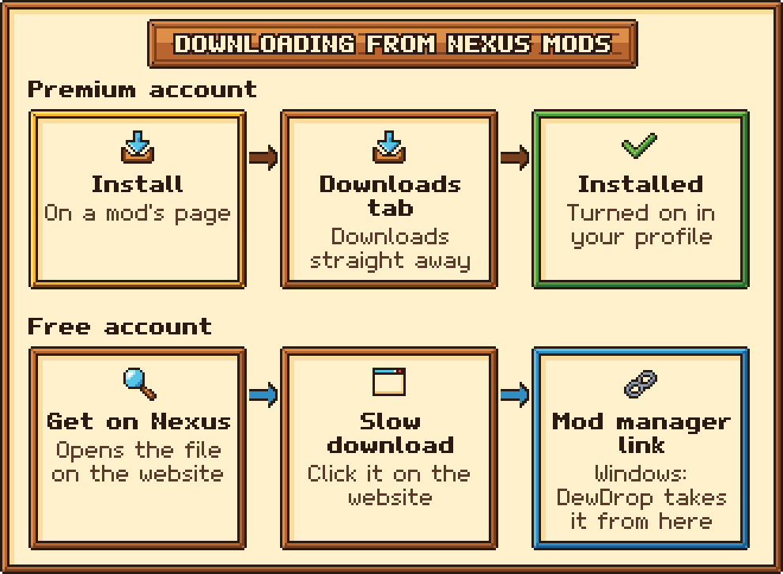

# Free vs Premium downloads

Nexus Mods only lets **Premium** members download files straight into an app. With a **free** account you can still install mods from DewDrop on Windows: you start the download on the Nexus Mods website, and the website hands the file to DewDrop.

Either way, log in first (see [Connecting your Nexus account](connecting.md)). Until you do, the button next to each file on a mod's page says **Log in to install** and takes you to the **Account** tab.

<figure><figcaption><p>Premium downloads go straight into the game. Free downloads take a short trip through the website.</p></figcaption></figure>

| | Premium | Free |
| --- | --- | --- |
| Button next to each file on a mod's page | **Install** (green) | **Get on Nexus** |
| What it does | DewDrop downloads and installs the file | Your browser opens the file on Nexus Mods. You click **Slow download**, and the website sends the file to DewDrop |
| One-time setup | None | [Turn on mod manager links](mod-manager-links.md) |
| Works on | Every system, including the Steam Deck | Windows only, for now |
| **Update to** button on the **Installed** tab | Downloads and installs the update | Opens the update on Nexus Mods, where you click **Slow download** |
| Button on a failed download | **Retry** | **Get on Nexus** |

A file you already have says **Installed** in green instead of a button, whichever account you have. To install it again, uninstall it first. See [Which file counts as installed](../guides/mod-page.md#which-file-counts-as-installed).

## Premium: install in one click

1. On the **Browse** tab, click a mod to open its page.
2. Click the green **Install** button next to the file you want.
3. The button shows **Queued...**, then **Downloading** with a percentage, then **Installing...**. You can follow along on the **Downloads** tab.
4. A message says the file was installed and to "Restart to load it." With **Turn on mods when installed** on (the default), the new mod is already on in your profile.
5. Click **Apply & Restart** to load it.

<figure><figcaption><p>A mod's page. Each file has its own install button.</p></figcaption></figure>

[A mod's page and installing files](../guides/mod-page.md) covers the page in detail, and [Apply & Restart](../guides/apply-and-restart.md) explains the restart.

## Free account on Windows

Do the one-time setup first: on the **Account** tab, click **Use DewDrop for these links** in the **Mod manager links** panel. ["Mod manager download" links](mod-manager-links.md) walks you through it. Until you do, the **Downloads** tab shows a **Set up** button that takes you there.

Then, for each mod:

1. On the **Browse** tab, open the mod and click **Get on Nexus** next to the file you want. Your browser opens that file on the Nexus Mods website, and DewDrop says "Click 'Slow download' on the website; DewDrop installs it when it arrives."
2. On the website, click **Slow download**. If your browser asks whether it may open the link with another program, allow it.
3. Go back to the game. Within a second or two, the download shows up on the **Downloads** tab and installs, the same way a Premium download does.
4. Click **Apply & Restart** to load the new mod.

Good to know:

* **Game closed?** If you click **Slow download** while the game is closed, DewDrop picks the download up the next time you start the game.
* **Old link?** The website's links expire after a while. If you see "The website's download link for Nexus mod ... expired. Click it on the website again.", click **Slow download** on the website again.
* **Links going elsewhere?** If another program has the links, for example because Stardrop took them back, DewDrop warns you when you click **Get on Nexus**. See [When Stardrop or Vortex takes the links back](mod-manager-links.md#when-stardrop-or-vortex-takes-the-links-back).

## Free accounts on macOS and Linux

The website can only hand files to DewDrop on Windows for now. On macOS and Linux, including the Steam Deck, **Get on Nexus** still opens the file on the website, but nothing sends the download back to DewDrop. DewDrop tells you so when you click: "Opened the file on Nexus Mods. Mod manager links only work on Windows for now, so add the mod to your Mods folder yourself."

### Install the mod by hand

1. On the website, download the file with the **Manual download** button.
2. Extract it so the mod's folder, the one with `manifest.json` in it, ends up in your `Mods` folder. The **Settings** panel on the **Account** tab shows that folder as "Mods folder". On a Steam Deck, do this in Desktop Mode.
3. In the game, click **Rescan** on the **Installed** tab. The mod shows up there, turned on if **Turn on mods when installed** is on (the default). If it's off, turn the mod on.
4. Click **Apply & Restart**.

See [Managing your mods](../guides/installed.md) for more.

### Paste the link into the SMAPI console (advanced)

If you can copy the `nxm://` link the website tries to open, type `dewdrop_nxm`, a space and the link in the SMAPI console window, then press **Enter**:

```text
dewdrop_nxm nxm://stardewvalley/mods/<mod id>/files/<file id>?key=...&expires=...&user_id=...
```

DewDrop downloads and installs it like any other download. You need to be logged in, and the link expires after a while, so use it right away. See [Console commands](../reference/console-commands.md).

This needs a SMAPI console window, so it doesn't work everywhere:

* **Steam Deck, or Linux after the installer's `--steam-setup`:** Steam starts the game through DewDrop's Steam launcher, which starts SMAPI without a console window. Install by hand instead.
* **macOS:** a game DewDrop restarted with **Apply & Restart** probably has no console window. Start the game the usual way to use the command.

Premium downloads don't need the website's links at all, so the **Install** button works the same everywhere. DewDrop is tested mainly on Windows so far; see [Platform support](../reference/platform-support.md).

## If a download fails

| Message | What it means |
| --- | --- |
| "Direct downloads need Nexus Premium. Use 'Get on Nexus' instead." | Nexus Mods says your account isn't Premium. If your membership recently ended, restart the game so DewDrop sees your free account. |
| "This download link has expired. Click 'Slow download' on the mod's Nexus page again." | The website's link was too old. Start the download on the website again. |
| "Nexus didn't accept this download link for your account. Start the download again from the mod's Nexus page." | The link was made for a different account, or is no longer valid. Start again on the website. |
| "Nexus didn't accept your API key. Log in again on the Account tab." | Your saved key no longer works. Log out, then log in again with a fresh copy of your key. |
| "You've reached Nexus Mods' download limit for now. Try again later." | Nexus Mods is limiting your downloads. Wait a while, then use **Retry** or **Get on Nexus** on the **Downloads** tab. |
| "Nexus Mods no longer has this file." | The author removed it. Pick another file on the mod's page. |

DewDrop doesn't download a mod's required mods for you, so install each one the same way. When you turn a mod on, DewDrop also turns on any of its required mods that are already installed. [Downloads](../guides/downloads.md) has more on the download list.
